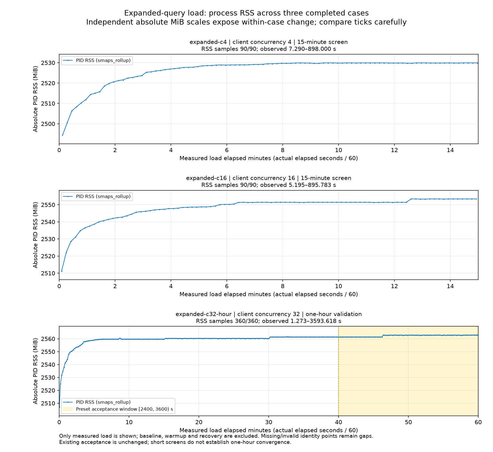

# 扩大查询与并发：容器持续验证

日期：2026-10-25。三档正常容器运行均完成，严格账本、查询覆盖与业务检查通过。c32 一小时预设末二十分钟 RSS 门槛通过：首末增长 **1.535156 MiB**，OLS **0.093627 MiB/分钟**。这是固定负载下的有限验证；CI 与合并状态见对应 PR，本文不预先宣称通过。

## 本轮改动与输入

本轮新增确定性负载查询生成器、不可变查询字节快照，以及查询覆盖/重复/顺序和实际客户端在途并发审计。没有新增服务请求路径修复，沿用进程 THP 关闭及 `MALLOC_ARENA_MAX=2`。Docker stats 无身份占位记录的处理修复属于离线绘图 helper，不是服务内存修复。历史分配器原因与 c4 小时证据见[上一轮报告](container-memory-arena-2026-10-25.md)。

查询从原 100 条扩展到 **1300 条**：保留原文、顺序及来源，另生成 1200 条，分为 7 个 family、覆盖 18 个内容 category；长度 8–256 字符。这些查询来自冻结物品及确定性变换，不是真实用户流量、人工标注或检索质量评测。

| 合成 family | 条数 |
|---|---|
| entity_heuristic | 200 |
| long | 200 |
| punctuation | 150 |
| short | 200 |
| title | 300 |
| unicode_fullwidth | 75 |
| unicode_natural | 75 |

fixture SHA-256：`7356dc96df3a6d0d8bfc5c00d74ec284d7df22efec5bddba127b462e75be3ef6`。生成器 seed：`searchpilot-expanded-load-v1`。实际每轮使用字节均单独保存并校验；fixture CSV/manifest 只随原始证据 ZIP 发布，不替换或提交原 queries/labels、私有 `.env`、原始数据和模型。

## 持续请求与正确性

三档顺序运行，各用独立 Compose 项目、全新 PostgreSQL 卷和 API 进程；四模式混合轮转，limit=10、总超时 10 秒、顺序预热 16 次、闭环无重试。以下吞吐分母为实际测量时长（含排空），延迟为成功请求的 nearest-rank 分位数；所有已发请求保留在成功/失败/未知分母中。

| case | 调度秒 | 正式成功/发出 | 预热 | 实际在途峰值 | 总分母秒 | 成功 req/s | p95 ms | p99 ms |
|---|---|---|---|---|---|---|---|---|
| expanded-c4 | 900 | 9358/9358 | 16/16 | 4 | 900.274857 | 10.394603 | 711.616 | 878.181 |
| expanded-c16 | 900 | 12538/12538 | 16/16 | 16 | 900.912335 | 13.917003 | 1823.206 | 2269.192 |
| expanded-c32-hour | 3600 | 53309/53309 | 16/16 | 32 | 3601.865927 | 14.800384 | 3200.383 | 3451.563 |

| case | 预期组 | 实际组 | 至少重复 | 实际正式重复分布 |
|---|---|---|---|---|
| expanded-c4 | 5200 | 5200 | 1 | 1042 组×1次；4158 组×2次 |
| expanded-c16 | 5200 | 5200 | 1 | 3062 组×2次；2138 组×3次 |
| expanded-c32-hour | 5200 | 5200 | 3 | 3891 组×10次；1309 组×11次 |

各档零失败、零未知、零遗留、零空成功；查询文件哈希与轮转顺序一致。每个查询×模式的结果、排名及模型三元组在轮内稳定，且三档全部组跨轮一致。实际在途峰值来自客户端pending/result 顺序，不代表服务端实际同时执行线程数，也不证明超时后服务端已取消计算。

跨档语义 SHA-256：`6fbe24fc97b9b6d6eb6c7670a00c473135d0860c24005c24b52dd383d51afd7b`。

| case | 正式开始 UTC | 排空结束 UTC | 排空秒 |
|---|---|---|---|
| expanded-c4 | 2026-10-25T05:52:12.872967+00:00 | 2026-10-25T06:07:13.147710+00:00 | 0.274857 |
| expanded-c16 | 2026-10-25T06:10:59.479215+00:00 | 2026-10-25T06:26:00.391459+00:00 | 0.912335 |
| expanded-c32-hour | 2026-10-25T06:29:41.896682+00:00 | 2026-10-25T07:29:43.762635+00:00 | 1.865927 |

## 健康、业务与来源

| case | load live | load ready | 正式窗内点 | 窗外 load 点 | load 首末相对秒 | 最大间隔秒 |
|---|---|---|---|---|---|---|
| expanded-c4 | 91/91 | 91/91 | 90 | 1 | -2.719491→897.999539 | 10.023123 |
| expanded-c16 | 90/90 | 90/90 | 90 | 0 | 5.195316→895.783199 | 10.025235 |
| expanded-c32-hour | 361/361 | 361/361 | 360 | 1 | 1.272590→3603.632859 | 10.029315 |

正式窗使用 `[0,duration)`；phase=load 可能覆盖启动和排空边界，因此逐项披露实际计数，不强填每小时 360 次。全部 load ready 组件为真，数据源可用、PID1 身份一致，THP、AnonHugePages、swap 与三项 OOM 计数均为零，无意外重启。启动/计划重启阶段的不可用记录保留在原始账本，不混入负载成功分母。每档 17 项业务/重启检查通过，反馈创建、幂等回放与重启后读取为同一记录，最终只新增一条反馈。

| case | 容器源码数 | 安装源码数 | THP disable | arena max | 末快照 Docker Health |
|---|---|---|---|---|---|
| expanded-c4 | 77 | 73 | true | 2 | starting |
| expanded-c16 | 77 | 73 | true | 2 | starting |
| expanded-c32-hour | 77 | 73 | true | 2 | starting |

HTTP restart_ready 与反馈持久性用于重启业务验收；末快照 Docker Health 单独披露。正常入口为 `python scripts/docker_entrypoint.py`；白名单环境在多个容器状态快照中直接记录，其他 native override 未设置。无诊断 wrapper、tracing、定时 GC 或 malloc_trim。

镜像：`searchpilot-validation:2026-10-25-expanded`，ID：`sha256:e858d8af87d05a191aae11682d8098f3285eed0b487985d2fb3edf06492a36f1`。冻结输入 29 个、源码 185 个，容器及安装源码均核对；依赖与模型未重建。

## 内存

PID RSS 的全 phase-load、严格正式窗、严格末十/二十分钟及恢复期如下。各端点差仅覆盖实际采到的时间跨度，不等同完整窗口首尾瞬时值；短档不存在完整末二十分钟。

| case | 范围 | 点数 | 跨度秒 | RSS首→末 MiB | 差 MiB | OLS MiB/min |
|---|---|---|---|---|---|---|
| expanded-c4 | 全部 phase-load | 91 | 900.719 | 2482.082→2529.918 | +47.835938 | +1.262667 |
| expanded-c4 | 严格正式窗 | 90 | 890.710 | 2494.426→2529.918 | +35.492188 | +1.108675 |
| expanded-c4 | 严格末十分钟 | 60 | 590.461 | 2528.461→2529.918 | +1.457031 | +0.116135 |
| expanded-c4 | 严格末二十分钟 | 不适用 | — | — | — | — |
| expanded-c4 | 恢复期 | 6 | 50.027 | 2529.918→2528.965 | -0.953125 | -1.015260 |
| expanded-c16 | 全部 phase-load | 90 | 890.588 | 2511.184→2553.387 | +42.203125 | +1.203924 |
| expanded-c16 | 严格正式窗 | 90 | 890.588 | 2511.184→2553.387 | +42.203125 | +1.203924 |
| expanded-c16 | 严格末十分钟 | 60 | 590.357 | 2548.754→2553.387 | +4.632812 | +0.351087 |
| expanded-c16 | 严格末二十分钟 | 不适用 | — | — | — | — |
| expanded-c16 | 恢复期 | 6 | 50.049 | 2553.387→2550.277 | -3.109375 | -2.754028 |
| expanded-c32-hour | 全部 phase-load | 361 | 3602.360 | 2506.926→2562.730 | +55.804688 | +0.147774 |
| expanded-c32-hour | 严格正式窗 | 360 | 3592.345 | 2506.926→2562.910 | +55.984375 | +0.148280 |
| expanded-c32-hour | 严格末十分钟 | 60 | 590.265 | 2562.781→2562.910 | +0.128906 | +0.008199 |
| expanded-c32-hour | 严格末二十分钟 | 120 | 1190.483 | 2561.375→2562.910 | +1.535156 | +0.093627 |
| expanded-c32-hour | 恢复期 | 12 | 110.092 | 2557.008→2556.832 | -0.175781 | -0.077134 |

c16 的严格末十分钟仍增长 **4.632812 MiB**；两个 900 秒短档是功能、覆盖及资源筛查，不据此宣称内存收敛。

c32 小时预设门槛保持 OLS ≤0.1 MiB/min、增长 ≤2 MiB；严格 `[2400,3600)` 至少 118 点、跨度≥1180秒、间隔≤15秒。实际 120 点、跨度 1190.482580 秒、最大间隔 10.020414 秒，同进程完整数据，原门槛通过。

全部五分钟闭开窗口：

| case | 分钟窗 | 点数 | RSS中位 MiB | 差 MiB | OLS MiB/min |
|---|---|---|---|---|---|
| expanded-c4 | [0,5) | 30 | 2522.617 | +33.687500 | +5.397806 |
| expanded-c4 | [5,10) | 30 | 2529.512 | +1.375000 | +0.307601 |
| expanded-c4 | [10,15) | 30 | 2529.918 | +0.085938 | -0.001018 |
| expanded-c16 | [0,5) | 30 | 2544.021 | +37.445312 | +5.017397 |
| expanded-c16 | [5,10) | 30 | 2551.449 | +2.695312 | +0.470119 |
| expanded-c16 | [10,15) | 30 | 2552.375 | +1.937500 | +0.582671 |
| expanded-c32-hour | [0,5) | 30 | 2553.268 | +51.906250 | +6.884935 |
| expanded-c32-hour | [5,10) | 30 | 2559.719 | +0.757812 | +0.098854 |
| expanded-c32-hour | [10,15) | 30 | 2559.723 | -0.011719 | -0.002716 |
| expanded-c32-hour | [15,20) | 30 | 2560.297 | +0.574219 | +0.020210 |
| expanded-c32-hour | [20,25) | 30 | 2560.297 | +0.011719 | -0.001959 |
| expanded-c32-hour | [25,30) | 30 | 2560.297 | -0.082031 | -0.003242 |
| expanded-c32-hour | [30,35) | 30 | 2561.381 | +1.019531 | +0.046019 |
| expanded-c32-hour | [35,40) | 30 | 2561.387 | +0.000000 | +0.006662 |
| expanded-c32-hour | [40,45) | 30 | 2561.387 | +0.011719 | +0.004336 |
| expanded-c32-hour | [45,50) | 30 | 2562.711 | +1.312500 | +0.324938 |
| expanded-c32-hour | [50,55) | 30 | 2562.781 | -0.082031 | -0.003397 |
| expanded-c32-hour | [55,60) | 30 | 2562.816 | +0.128906 | +0.023709 |

| case | 独立范围（严格正式窗） | 有效点 | 首→末 MiB | 采样最大 MiB |
|---|---|---|---|---|
| expanded-c4 | PID PSS | 90/90 | 2490.977→2526.462 | 2526.533 |
| expanded-c4 | PID anonymous | 90/90 | 2219.129→2224.301 | 2224.301 |
| expanded-c4 | PID VmData | 90/90 | 5819.695→5869.891 | 5875.859 |
| expanded-c4 | cgroup current | 90/90 | 3211.363→3216.848 | 3229.988 |
| expanded-c4 | 客户端 RSS | 90/90 | 52.406→59.164 | 59.164 |
| expanded-c16 | PID PSS | 90/90 | 2507.670→2549.957 | 2550.020 |
| expanded-c16 | PID anonymous | 90/90 | 2235.738→2246.789 | 2246.789 |
| expanded-c16 | PID VmData | 90/90 | 6567.309→6591.402 | 6591.402 |
| expanded-c16 | cgroup current | 90/90 | 2293.777→2304.953 | 2314.699 |
| expanded-c16 | 客户端 RSS | 90/90 | 53.352→64.492 | 64.492 |
| expanded-c32-hour | PID PSS | 360/360 | 2503.406→2559.502 | 2559.502 |
| expanded-c32-hour | PID anonymous | 360/360 | 2236.586→2256.508 | 2256.508 |
| expanded-c32-hour | PID VmData | 360/360 | 7158.551→7336.004 | 7336.004 |
| expanded-c32-hour | cgroup current | 360/360 | 2297.164→2317.566 | 2329.734 |
| expanded-c32-hour | 客户端 RSS | 360/360 | 54.648→104.129 | 104.129 |

PID RSS/PSS、匿名页、VmData、cgroup 和客户端内存不相加，也不互相替代；VmData 是虚拟数据区大小。十秒离散采样最大值不是连续真实峰值。完整指标、缺失值及来源见原始 JSON。



## 背景负载与解释边界

| case | 范围 | polls | 有其他容器 | 累计其他ID | 单次最多其他容器 | stats缺失轮 | 无身份记录 | loadavg缺失轮 |
|---|---|---|---|---|---|---|---|---|
| expanded-c4 | 严格正式窗 | 90 | 54 | 103 | 6 | 0 | 0 | 0 |
| expanded-c4 | 完整捕获 | 109 | 60 | 110 | 6 | 0 | 1 | 1 |
| expanded-c16 | 严格正式窗 | 90 | 0 | 0 | 0 | 0 | 0 | 0 |
| expanded-c16 | 完整捕获 | 107 | 2 | 4 | 2 | 0 | 0 | 1 |
| expanded-c32-hour | 严格正式窗 | 359 | 8 | 17 | 3 | 0 | 0 | 0 |
| expanded-c32-hour | 完整捕获 | 385 | 11 | 26 | 3 | 0 | 0 | 1 |

累计 ID 不等于同时运行数；单次最多值也仅限采样时刻。c16 正式窗未采到其他容器不证明宿主无争用；这里只采 Docker stats 与容器内 `/proc/loadavg`，未完整监测 Windows宿主 CPU。不同档的背景负载、请求量及排队成本不同，不将吞吐差异称为因果加速，不据此给出容量 SLA、真实流量代表性、检索相关性或无限运行无泄漏结论。

## 本地检查与复现

保存的本地记录：单元 **664 passed、3 skipped、14 deselected、68 subtests passed**；真实 PostgreSQL 集成 **14 passed**。Ruff、190 文件格式检查与 73 源文件 Mypy 通过。跳过和未选测试不计为通过；日志包含既有弃用警告。CI/合并状态由对应 PR 核实。

本轮 `external_llm_calls=0`；[历史外部 LLM 验证](agent-llm-live-2026-10-14.md)的 100 次调用属于独立历史记录，不覆盖为本轮调用，也不被本轮零调用抹除。

从仓库根目录执行以下参数；先解压原始 ZIP 到独立目录，重跑更换项目、端口与输出目录。保持模型、数据与查询字节一致，顺序完成短档后再运行小时档：

```powershell
.venv/Scripts/python.exe -m scripts.build_load_queries --data-version d3a904f41240 --out artifacts/expanded-repro/fixture
.venv/Scripts/python.exe -m scripts.validate_container_soak --out artifacts/expanded-repro/c32 --project sp-expanded-repro-c32 --image searchpilot-validation:2026-10-25-expanded --api-port 18133 --db-port 15533 --duration-seconds 3600 --concurrency 32 --baseline-seconds 60 --recovery-seconds 120 --queries artifacts/expanded-repro/fixture/queries.csv
.venv/Scripts/python.exe -m scripts.summarize_soak --bench artifacts/expanded-repro/c32/soak.json --ledger artifacts/expanded-repro/c32/soak.requests.jsonl --samples artifacts/expanded-repro/c32/samples.jsonl --queries artifacts/expanded-repro/c32/queries.csv --min-repeats 3 --duration-seconds 3600 --out artifacts/expanded-repro/c32/analysis.json
```

以上是核心执行参数；十秒背景观察、独立资源/内存门槛验收、清理和绘图仍按 ZIP 中的 `run_case.py`、`audit_case.py`、`cleanup_owned.py`、`render_evidence.py` 执行，不能用核心命令的退出码替代全部验收。

## 可核查证据

- [机器可读摘要](container-expanded-soak-2026-10-25-summary.json)：与 `aggregate.json` 原字节一致。
- [原始证据 ZIP](container-expanded-soak-2026-10-25-raw.zip)：141 个证据文件，142 个 ZIP 成员（含 SHA 清单），33,366,554 字节；CRC 与全部成员 SHA-256 回读通过。
- ZIP SHA-256：`2097a61a9b97e9dd0e1fae5dd53420eabc2b655bbbce06082c5a613af6c50fed`。

凭据模式/结构化扫描范围以归档核验记录为准，不将模式扫描等同任意未知私密值检查。私有 `.env` 不归档；公开配置副本仅保存为 `public-env.txt`。
