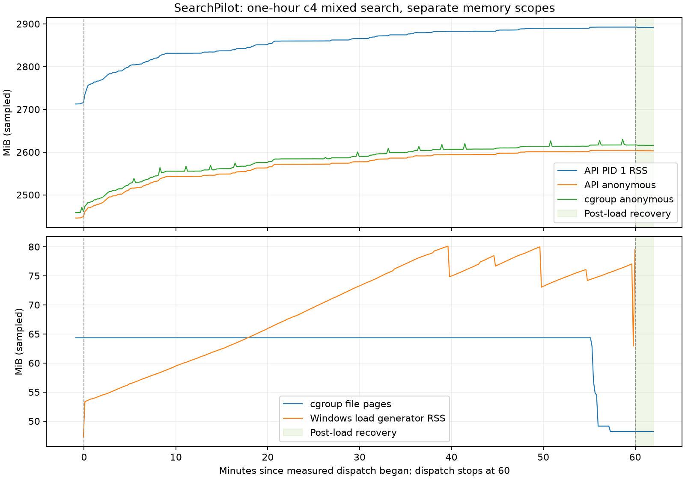

# 2026-10-23 一小时容器验证与内存排查

本轮延长 [十分钟混合压测](container-soak-2026-10-22.md)，将 API 进程、容器与
Windows 客户端内存分别记录。历史 Docker 显示值约增长 93 MiB，不能据此判定泄漏，
也不能解释为客户端的请求记录占用。以下诊断与正式 HTTP 持续运行分别计账。

## 已复现并修复的并发错误

独立组件诊断直接调用真实搜索服务，四线程、100 条查询、四种模式。原镜像完成
400 次预热后，在开启 tracemalloc 的第一段中触发 Snowball `IndexError`。
`stemWords()` 共用一个可变的英文词干器；词干器的 `current`、游标等状态会被另一
请求改写。GIL 不保证整个词干化调用原子执行。

真实库回归在 `_stem()` 前主动让出线程，以保留真实算法并放大合法交错：旧代码
出现跨请求词干污染。修复只给共享实例的 `stemWords()` 加锁；数字、缩写等不需要
词干化的分支仍直接返回。没有更换算法、修改模型权重或重新生成标签与索引。

## 单独的插桩诊断

修复后的同脚本完成 400 次预热和三段各 60 秒负载，共 3,967 次组件调用。预热覆盖
400 个查询/模式组合；后续重复涉及 166 个组合，所观察到的重复调用没有指纹变化。
各线程固定一种模式，每段重新从首条查询开始，BM25 调用占多数；其余三种模式
每段只覆盖前 22 条左右。因此不能把这轮吞吐、覆盖或分布当作正式公平轮转 HTTP
压测。原失败轮的第一段没有逐调用账本，
只确认 400 次预热完成及随后发生异常，不补造失败前调用总数。

三段结束的 RSS 分别为 1,169,604,608、1,172,512,768、1,172,553,728 字节，
追踪启用后仍活跃的 Python 分配分别约 51、60、67 KiB。这些追踪值不包含启用前
已经加载的模型和索引，也不能覆盖所有原生分配。末尾 `gc.collect()` 收集 132 个
对象但 RSS 未下降；随后一次 `malloc_trim(0)` 将 RSS 降至 1,145,024,512 字节，
回收 27,529,216 字节，约 26.25 MiB。该结果支持这轮存在可回收的分配器保留，
不能证明所有内存增长都来自它，更不能证明长期无泄漏。tracemalloc 自身也有原生
开销，本轮没有单独计量其内部内存，因此这 26.25 MiB 不能当作正式 HTTP 服务可回收量。

实际镜像的 sentence-transformers 6.2.0 `encode()` 已使用 `torch.inference_mode()`；
运行时 forward hook 共观察到 494 次编码，全部 `grad_enabled=False`、
`inference_mode=True`。没有依据添加关闭梯度的额外补丁。

正式运行使用原服务入口，不启用 tracemalloc、forward hook、GC 或 trim 干预。

## 正式运行协议

基线提交 `942d2d8067f4d662daced70e0d75cde0295202b0` 加上述词干器锁修复。
验证镜像由上次镜像派生，只覆盖源码目录和实际 site-packages 中的 `normalize.py`，
保留依赖和缓存模型，避免重装未锁定依赖引入混杂因素。原镜像 ID 为
`sha256:0976837bae1469297fa55e2f198e4b3ca00ef7582912479d46bc912233c75e9a`；
派生镜像 ID 为 `sha256:5dace93aa828fdece3cc5f689edf8c08db98f0d2a6900236cccbdafedbefed6d`。
正式负载前逐文件比对镜像源码、实际安装源码和本地源码；26 份输入、迁移、模型产物的
SHA-256 与上轮相同。

隔离 Compose 项目为 `sp-hour-20261023`，API/数据库仅绑定本机 18082/15433 端口，
使用全新 PostgreSQL 16 卷；原 `searchpilot_pgdata` 不参与运行。显式传入公开的
`.env.example`，并清除继承的服务、数据库与 Compose 配置，私有 `.env` 没有加载。
数据和模型只读挂载，运行时模型离线，外部 LLM 调用为 0。

启动后检查全量导入计数和 12 项业务请求，观察 60 秒空闲基线。随后闭环并发 4、
100 条 CSV 查询、BM25/vector/hybrid/LTR 公平轮转、limit 10，每模式预热 4 次，
正式派发 3,600 秒，到期停止派发并排空在途请求。单请求 10 秒总截止时间，无重试。
最终检查四种搜索响应、观察 120 秒空闲恢复，再停止/启动 API 并验证反馈持久性。

每约 10 秒独立读取 PID 1 的 `/proc/status`、`smaps_rollup`、启动标识和 FD 数，
以及 cgroup v2 的精确字节计数、分类、OOM 事件和 Docker stats；live/ready 各自有
总截止时间及响应体上限。短暂的 `docker exec` 观察进程会增加 cgroup 占用，但不
计入 API PID 1 RSS。各来源读取不是原子快照，离散采样最大值不等于连续峰值。

Windows 虚拟环境的 `python.exe` 会再启动实际 Python 进程。工具通过 PID 注册与
开始门闩找到真实负载进程，持有句柄避免 PID 复用，单独采集其 working set/private
bytes。客户端仍保留 O(N) 请求字典供精确统计，增长不能解释成 API 的内存泄漏。
父任务的负载总预算覆盖正式时间、预热、排空和保存；超时、取消、采样任务退出时
终止并回收自己拥有的负载进程。某个探测失败不会遮蔽其他探测，失败账本仍保留。

离线分析器使用 12 个半开 300 秒派发窗口。重复、失败和未配对的 UNKNOWN 都明确
报告；不因错误先抛断言而丢掉所有汇总。顶层 `PASSED` 仅代表账本与 benchmark
自洽，资源/健康结果独立列出，不自动等同于长期稳定性或无泄漏验收。

## 本轮结果

正式测量时间为 2026-10-23 06:42:49.982–07:42:50.269 UTC，派发 3,600 秒，
含排空总计 3,600.287 秒。Docker Desktop Linux 获配 12 CPU、8,171,167,744 字节内存；
单 API worker、闭环并发 4。宿主后台负载未受控，以下吞吐不是容量上限或 SLA。

独立逐行核对 85,230 个账本事件：42,615 个 pending 和 42,615 个 result，
其中正式 **42,599/42,599 成功**，预热 **16/16 成功**。重复、孤立、未完成、
UNKNOWN、超时和空结果均为 0；峰值在途 4。400 个查询/模式组合各观察 106–108 次
成功响应，排名和完整结果指纹均一致，模型版本未变化。这证明固定夹具结果一致，
不证明检索相关性或通用回答质量。

| 模式 | 正式成功/派发 | p50 / p95 / p99（ms） | 最大（ms） |
|---|---:|---:|---:|
| BM25 | 10,650/10,650 | 23.84 / 107.75 / 160.62 | 306.57 |
| vector | 10,650/10,650 | 392.73 / 582.66 / 714.19 | 1,012.37 |
| hybrid | 10,650/10,650 | 414.70 / 609.85 / 747.19 | 1,304.01 |
| LTR | 10,649/10,649 | 469.50 / 658.45 / 797.61 | 1,172.73 |
| 混合 | 42,599/42,599 | 387.33 / 601.59 / 734.57 | 1,304.01 |

混合完成速率为 11.83 req/s。以下均按派发时间划入五分钟窗口，延迟包含该窗口
请求的最终完成；各窗口成功数等于派发数，每种模式均有覆盖。RSS 中位数来自每窗
30 个有效采样点，不是单请求分配量。

| 分钟窗口 | 成功请求 | p95 / p99（ms） | API RSS 中位数（MiB） |
|---|---:|---:|---:|
| 0–5 | 3,388 | 625.1 / 746.7 | 2,779.56 |
| 5–10 | 3,272 | 625.1 / 761.1 | 2,817.89 |
| 10–15 | 3,210 | 648.7 / 766.2 | 2,831.42 |
| 15–20 | 3,728 | 558.4 / 660.2 | 2,842.78 |
| 20–25 | 3,875 | 535.3 / 630.6 | 2,859.86 |
| 25–30 | 4,007 | 509.0 / 583.4 | 2,862.34 |
| 30–35 | 3,834 | 542.3 / 629.2 | 2,872.15 |
| 35–40 | 3,264 | 694.6 / 872.8 | 2,879.71 |
| 40–45 | 3,790 | 549.6 / 675.6 | 2,882.84 |
| 45–50 | 3,681 | 576.4 / 714.2 | 2,888.27 |
| 50–55 | 3,350 | 627.9 / 744.4 | 2,889.47 |
| 55–60 | 3,200 | 641.7 / 763.1 | 2,892.41 |



负载期的 360 个采样点中，API PID 1 的 RSS 从 **2,734.95 增至 2,892.55 MiB**，
增加 **157.60 MiB**，其中匿名驻留页增加 **143.48 MiB**。增长后段放缓，最后约十分钟
首末采样仍增加 **3.24 MiB**。120 秒恢复期的 12 点 RSS 仅下降 **0.95 MiB**，
没有回到基线。不能宣称已收敛、泄漏已解决，或把词干器锁当作内存修复。

cgroup file 从 64.35 降至 48.21 MiB；cgroup current 首末为 2,642.38/2,709.84 MiB，
采样最大 2,735.22 MiB。其口径与 PID RSS 不同，采集也不是原子操作，不能相减归因。
Windows 负载进程 RSS 首末为 53.35/79.53 MiB、采样最大 80.11 MiB；私有字节和
缺失记录另见 JSON。客户端退出后的缺失值保留为 null，不伪造为 0。

负载期 PID 1 启动标识全程一致，FD 为 20–21，线程数 89–100，OOM、OOM kill、
OOM group kill 的计数及增量均为 0。live 和 ready 各 **360/360** 返回 200，
采样源错误为 0，最大采样间隔 10.027 秒。空闲基线各 6/6、恢复期各 12/12 返回 200。
启动期每端点 6 次中有 5 次连接/协议错误；主动重启期每端点 5 次均为协议错误，
均保留在原始记录中，不混入负载期分母。

首次 ready 为 49.069 秒，17 项业务检查均符合预期（12 个 200、3 个 201、
预期冲突 409 和不存在 404 各 1）。重启后 HTTP ready 的七项检查均通过，反馈以
同一 event_id 重放，表计数只比初始多 1 条反馈。最终 Docker 健康状态快照仍为
`starting`，本轮验收的是 HTTP ready 与业务恢复，不声称该时刻已变为 Docker healthy。

源码/依赖路径复查未发现可确认的逐请求无限保留链，但仍未区分原生对象、缓存和
分配器保留。并发词干化错误已修复；**内存增长机制和更长时间是否收敛仍未确认**。
后续归因应另开相同请求量、相同模式比例的独立诊断对照，并计量 tracemalloc 自身
开销；不在这条正式曲线上补做 GC/trim 后再宣称增长消失。

本地最终验证：**596 个单元测试、68 个 subtest、14 个真实 PostgreSQL 集成测试**
通过，Ruff、格式检查和 Mypy 通过。单元测试保留 1 条上游弃用警告，集成测试保留
14 条警告。26 份冻结输入哈希不变，三份实际执行的测量脚本与最终源码一致；正式
负载期间仅修改了未执行的离线分析器，最终分析器快照另存。隔离容器、网络和本轮
卷已清理，原 `searchpilot_pgdata` 的元数据不变。

机器可读结果见 [汇总 JSON](container-hour-2026-10-23-summary.json)，
完整账本、采样、容器日志、诊断失败/成功记录、执行脚本快照和检查日志见
[原始证据 ZIP](container-hour-2026-10-23-raw.zip)。ZIP 内含逐文件 SHA-256，外部
汇总记录 ZIP 哈希；打包后逐成员核验并扫描私有配置的密钥值。私有 `.env`、原始
数据和模型不在包内，历史 annotator 与模型栈不变。

## 复现入口

准备已有 data/artifacts 和已构建的验证镜像，在仓库根目录运行：

```powershell
.venv/Scripts/python.exe -m scripts.validate_container_soak `
  --out artifacts/new-hour-run --project sp-new-hour-run `
  --image searchpilot-validation:2026-10-23-memory `
  --duration-seconds 3600 --concurrency 4 --api-port 18082 --db-port 15433

.venv/Scripts/python.exe -m scripts.summarize_soak `
  --bench artifacts/new-hour-run/soak.json `
  --ledger artifacts/new-hour-run/soak.requests.jsonl `
  --samples artifacts/new-hour-run/samples.jsonl `
  --out artifacts/new-hour-analysis.json --duration-seconds 3600 --window-seconds 300
```

输出目录和 Compose 项目必须全新；已有容器、卷、网络或证据会被拒绝。验证结束后
保留隔离资源便于检查；核对项目标签和卷名称后，使用相同 Compose 参数执行
`down --volumes`，不要对其他项目执行清理。原始镜像并未发布到公共仓库；重新用
Dockerfile 构建会重新解析未锁定依赖，必须记录新版本，不能声称与本轮镜像完全相同。
