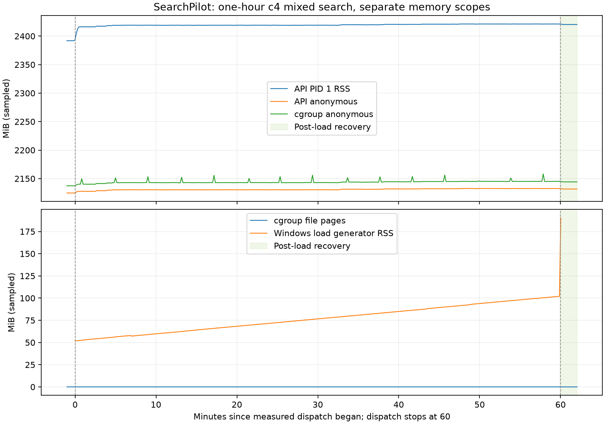

# 持续并发内存增长：glibc arena 对照与最终一小时验证

日期：2026-10-25。**两组各 16,000 请求的持续对照与最终正常入口一小时验证均完成。正式 53,650/53,650 成功，严格账本通过；预先固定的末二十分钟 RSS 门槛通过。** 名义健康采样次数存在已记录并由主审接受的边界计数偏差，见下文；本报告不表示 CI 或合并已完成。

本轮同协议 A/B 支持：glibc 多 arena 保留空闲内存是持续负载 RSS 增长的一个因果贡献因素。在本次顺序 A→B 对照中，默认策略与 arena 上限 2 的 400→16,000 请求 RSS 增长分别为 **45.953 / 3.609 MiB**，末约十分钟增长分别为 **24.961 / 0.652 MiB**。这不是对全部历史内存增长的唯一归因，也不是无限运行无泄漏的证明。

## 两层机制与证据边界

前一轮已通过 THP 开/关/开对照定位透明大页对 RSS 的贡献，采用进程级 `prctl` 控制，未更改宿主 THP 策略。方法、原始结果和一小时局限见 [THP 对照及一小时报告](container-memory-thp-2026-10-23.md)。那次关闭 THP 的完整一小时请求全部成功，但内存尾部仍增长，不能据此宣称问题全部解决。

本轮在两组都关闭 THP 的条件下，单独改变 glibc arena 上限。默认组 arena/free 字节随负载增加，而 used 字节基本不变；干预组 heap 数限制为 2，arena/free 和 RSS 增幅同时减小，Python 当前 arena 数保持不变。证据支持原生分配器空闲内存保留机制，区别于仅凭 RSS 上升推断业务对象泄漏。匿名 VMA 的地址、大小或对齐不能单独证明其属于 glibc、PyTorch、Arrow 或 Python。

## 固定条件与审计

使用独立 Compose 项目 `sp-allocator-20261025`，API 18085、PostgreSQL 15436；每组强制重建 API 为新进程，复用该项目已导入的同一份数据库。没有停止或修改其他项目容器，没有使用私有 `.env`。本轮外部 LLM 调用 **0 次**。

| 固定项 | 证据 |
|---|---|
| A / B | `no-thp-default-02` / `no-thp-arena2-01` |
| 唯一配置环境差异 | `MALLOC_ARENA_MAX` 未设置 / `2` |
| THP | 两组所有外部采样与 checkpoint 均 `THP_enabled=0`、AnonHugePages=0 |
| 镜像身份 | `sha256:d11f035548cfef1452d53c4f43d4e4e76c84d89026cc8dc4aad020579933568c` |
| 执行命令与源码 | 命令相同；5 份执行源码 SHA256 相同，落盘副本逐一核对 |
| 数据与模型 | 26 个冻结输入哈希相同，运行前后核对通过；原始 labels.csv、模型、权重、annotator 记录不变 |
| 其他 allocator 设置 | GLIBC_TUNABLES、LD_PRELOAD、PYTHONTRACEMALLOC 均未设置 |
| 运行身份 | 每组独立容器/PID；组内起始 tick 一致，0 重启 |

连续闭环并发为 4，16 次顺序预热后，按固定全局顺序运行 **100 queries × 4 modes × 40 repeats = 16,000 请求**，limit=10、timeout=10 秒、不重试。四个中途观察点（400/4k/8k/12k）不排空；通过独立线程执行诊断请求和 raw smaps 读取，业务 worker 持续发出请求。前后 inflight 均为 4，完成数继续增长。仅在第 16,000 个请求完成后自然排空。

独立 HTTP client 每十秒探测 live/ready，同时外部观察 PID1 内存、线程 ID、host loadavg 和全部容器的 Docker stats；健康连接不占用四个搜索连接。正常 Docker healthcheck 保留。诊断统计与 smaps 是顺序、非原子观测，不将不同内存口径相加。最后 idle 120 秒，之后才分别执行 GC 和 trim，记录各自结果；负载和 idle 阶段没有主动 GC/trim 或 tracing。

两组各 **16,016 个唯一 pending ID 与 16,016 个唯一 result ID** 完整配对；phase/index/mode/query 一致、结果时间不早于发送。正式请求均 **16,000/16,000 成功**，预热均 **16/16 成功**，0 timeout、0 empty success。limit 是上限，返回条数检查为 `0 < result_count <= 10`。

400 个语义组全部各重复 40 次；每组 result SHA256、ranking SHA256、model version 三元组稳定，并且跨组对照完全相同。

- 有序 issue 序列 SHA256：`7ae1352ef4e421728d82f6200571fa352819aeb7b598cf318eadd91928acb9fd`。
- 规范化 result/ranking/model 组指纹：`00ef0c703831fed04e19b397600a8325ba95f6fcef2ef82951d7b8e9cc03423c`。
- 执行驱动 SHA256：`e8664145a544bcfe2bf4e0a6a1237c99d0d326b4e6e2dc3cfb8525fb04703049`。
- 模型版本：`bm25-4f46b3d8`、`hybrid-51d4dcfb`、`ltr-4574f8f4`、`vector-b92663fd`。

完整审计以 `comparison-final.json` 为准；执行副本和当前冻结输入的独立实际文件校验在 `comparison-file-integrity.json`。先前 `no-thp-default-01` 因 Docker 环境列表裸 key 解析错误，在负载开始前失败，**0 业务请求**；原记录保留，不计入成功分母。驱动修正后使用新 case 名，未覆盖该失败记录。

## 16k 对照结果

单位 MiB；主表取诊断快照。中途快照包含正在执行请求的瞬态分配。

| 指标 | A：glibc 默认 arena 策略 | B：arena 上限 2 |
|---|---:|---:|
| warmup RSS | 2492.133 | 2501.250 |
| 400 RSS | 2529.898 | 2526.770 |
| 4,000 RSS | 2544.367 | 2528.891 |
| 8,000 RSS | 2551.102 | 2529.727 |
| 12,000 RSS | 2567.473 | 2529.547 |
| 16,000 RSS | 2575.852 | 2530.379 |
| **400→16,000 RSS 差** | **+45.953** | **+3.609** |
| 400→16,000 glibc arena 差 | +44.148 | +3.609 |
| 400→16,000 glibc free 差 | +44.156 | +3.733 |
| 400→16,000 glibc used 差 | −0.008 | −0.123 |
| glibc mmap（两端相同） | 95.949 | 95.949 |
| malloc_info heaps（400→16k） | 76→77 | 2→2 |
| pymalloc 当前 arenas（全程） | 642 | 642 |
| 400→16,000 pymalloc allocated blocks 差 | +0.006 | −0.047 |
| 末约十分钟外部 RSS 差 | +24.961 | +0.652 |
| 该窗口实际跨度 / OLS MiB/min | 590.303s / +2.981 | 590.128s / +0.071 |
| idle 120 秒后 RSS | 2574.988 | 2529.426 |
| idle 相对 16,000 RSS 差 | −0.863 | −0.953 |
| GC 后 RSS / 收集对象数 | 2574.992 / 40 | 2529.426 / 40 |
| trim 后 RSS | 2540.391 | 2495.246 |
| trim 相对 GC 后 RSS 差 | −34.602 | −34.180 |

两组 trim 均释放约 34 MiB，不能把 trim 总释放量直接等同于本轮新增内存。生产修复不引入周期 GC、malloc_trim、cron、额外控制线程或请求内采样。B 的尾部斜率较低是这组有限长度对照的结果；完整一小时在下文单独验收。

## 映射对账与线程观察

400→16k 的 raw smaps 净 RSS 差为 A **+45.86328125 MiB**、B **+3.41015625 MiB**。与主表的小差异来自业务继续运行期间的非原子观测。按地址范围、权限、offset、device、inode、path 完全一致的 identity 对账：

| 分区 | A RSS 差 MiB | B RSS 差 MiB |
|---|---:|---:|
| identity 完全匹配 | +0.1953125 | −0.0546875 |
| 新增 identity | +59.89453125 | +8.43359375 |
| 移除 identity | −14.2265625 | −4.96875 |
| 精确合计 | **+45.86328125** | **+3.41015625** |

所有已知 smaps 指标均通过分区总和校验。新增/移除也包含范围扩展、拆分、合并及可能的地址复用，不能将其直接解释为新建/销毁了同样大小的分配。完整最大增长映射、分类和 glibc 根节点 system/free-bin 数据保存在两组 `*-completed-maps.json`。

A/B 累计观察线程 ID 分别为 **354/367**，即时线程数范围都为 **67…101**，末次都是 67。B 并非因为观察到更少线程 ID 才呈现更低增长；但十秒采样可能漏掉短命线程，不能单凭 ID 将线程归属到某个库。

## 健康、吞吐与混杂

| 指标 | A | B |
|---|---:|---:|
| 正式成功请求 / 完整时间分母 | 16,000 / 1146.016s | 16,000 / 1169.817s |
| 成功请求/秒 | 13.961 | 13.677 |
| p95 / p99（ms，n=16,000） | 498.124 / 581.413 | 488.458 / 549.409 |
| load live / ready 成功 | 各 115/115 | 各 117/117 |
| post-load snapshot live / ready | 无独立轮次 | 各 1/1 |
| idle live / ready 成功 | 各 12/12 | 各 12/12 |
| 独立健康请求合计 | **254/254** | **260/260** |
| PID status / smaps 缺失，健康失败 | 0，0 | 0，0 |

时间分母覆盖整个正式请求区间及中途观察开销，排除预热、idle、GC 和 trim。初始/最终 readiness 与 Docker 自带探针未混入上表的独立探针分母。

A 在 26/127 份 Docker stats 样本中捕获其他项目容器，已知外部 CPU 百分比合计峰值 **236.90%**，另有 1 个 CPU 字段不可用；B 的 130 份样本未捕获其他项目容器，不能据此排除采样间短任务。两组实际时长、健康调用总数、线程调度、背景负载和启动时 RSS 不同，只有顺序 A→B 的一对实验，没有随机化或回切复现。**不把吞吐量或延迟差异解释为 arena 限制的因果效应，不声称性能非劣效性已获统计证明。**

## 配置与回滚

Dockerfile 与 Compose 在 Python 启动前默认设置 `MALLOC_ARENA_MAX=2`，Compose 允许覆盖；正常入口继续设置 `SEARCHPILOT_DISABLE_THP=true`。该 glibc 选项必须在进程启动前生效，不能通过已经运行的 Python 进程临时写环境变量来替代重新创建容器。

若需恢复本 glibc 的自动 arena 上限策略，显式设置 `MALLOC_ARENA_MAX=0` 并重新创建 API 容器。因为镜像和 Compose 的默认值已为 2，仅删除配置或将值留空会重新采用默认 2。`0` 的含义是回到由 glibc 自动确定上限的策略，不保证复现某个固定 heap 数或历史内存曲线；本轮 A 组实际使用的是未设置该变量。相关语义见 [glibc allocator 选项](https://sourceware.org/glibc/manual/latest/html_node/Memory-Allocation-Tunables.html) 与本运行版本 [glibc 2.41 arena_get2 实现](https://github.com/bminor/glibc/blob/glibc-2.41/malloc/arena.c#L760-L803)。

THP 和 arena 上限都是进程级部署策略，不更换模型、权重、标签、依赖或数据来源，不修改宿主 THP 设置。正常入口不会导入诊断 wrapper，诊断控制端口、主动 GC/trim 和 tracing 不进入正常服务运行路径。

## 最终正常入口一小时：业务与内存门槛通过

独立项目 `sp-arena-hour-20261025` 使用正常 `scripts/docker_entrypoint.py` 入口、THP 关闭、arena 上限 2。正式调度从 **2026-10-25 04:11:30.171764 UTC** 开始，持续 **3600 秒**，排空后于 **05:11:30.374858 UTC** 完成；此前基线 60 秒，随后恢复 120 秒并进行重启验证。harness 于 **05:14:04.247463 UTC** 完成。运行期间生产与测量源码冻结，没有诊断控制服务、tracemalloc、主动 GC 或 trim。

| 项目 | 实际结果 |
|---|---|
| 正式 / 预热 | **53,650/53,650 / 16/16 成功**；0 失败、未知、空结果和遗留 pending |
| 严格账本 | `PASSED`；107,332 条事件组成 53,666 个唯一完整配对请求；峰值在途 4 |
| 模式分母 | BM25 / vector 各 13,413；hybrid / LTR 各 13,412 |
| 语义稳定 | 400 组结果/排名/模型指纹稳定；50 组重复 135 次、350 组重复 134 次 |
| 吞吐 / 延迟 | **14.90194 请求/秒**；p95 **453.825 ms**、p99 **512.939 ms**（均 n=53,650） |
| 健康 | `phase=load` 的 live / ready 各 **361/361** 成功，ready 各组件为真；采样边界说明见后 |
| 业务 / 重启 | **17/17**，包含预期 409/404 拒绝；重启后同一反馈 event_id 幂等重放 |
| 数据库 | 5 个迁移、65,238 items、100 queries、1,012 labels、7 models、50 tasks、65,238 bids、6 experiments；feedback 从 0 到 1 |
| 进程与资源 | 361 个负载阶段样本均为 PID1 起始 tick **316977**；FD 16…21；无意外重启 |
| OOM / swap | 所有 361 个负载阶段样本 oom、oom_kill、oom_group_kill 和各 swap 字段完整且为 0；Docker OOMKilled=false |
| THP | 361/361 样本 `THP_enabled=0`、AnonHugePages=0 |

吞吐分母是全部正式请求完成的 **3600.2030419 秒**，包括约 0.203 秒排空；最后调度时间为 3599.9720924 秒，没有丢弃慢请求。独立审计从原始账本重建配对、模式与指纹，未复用主摘要计算函数，状态为 `PASSED_WITH_DOCUMENTED_COUNT_VARIATION`。`limit=10` 是上限；少于十条且非空的成功检索未错误计为失败。

重启业务验收以 `restart_ready` 七项检查全真和反馈持久性为据。最终 Docker 快照健康状态仍为 **starting**，其历史包含启动期连接拒绝，不能写成最终 Docker healthy。采样中 startup 4 轮、restart 3 轮的 HTTP 不可用记录完整保留，没有混入正式负载成功分母或被抹除。进程正常退出码为 0，计划重启前后 Docker RestartCount 均为 0；计划重启与意外重启分开记录。

### 健康次数与边界偏差

原验收方案名义要求负载期 live/ready 各 360 次；实际 phase-load 记录为 **361 次/端点**，该字面计数要求没有恰好满足。采样 phase 覆盖 benchmark 启动与末尾排空，首轮在正式开始前 **−0.762622 秒**，末轮在正式开始后 **3601.666050 秒**；严格 `[0,3600)` 内有 **359 轮**，另两轮分别包围起止边界。

361 轮全部成功，无缺失采样点，最小/最大间隔为 **9.979383 / 10.029266 秒**，整个调度区间被覆盖。独立审计记录了上述偏差，主审基于完整节奏、全探针成功及两端覆盖，**接受该名义次数偏差**；没有将计数强改为 360，没有改写原方案，也没有放宽下述内存门槛。报告将“实际覆盖通过”与“名义计数不相等”同时保留。

### 内存窗口与预先固定门槛

以正式开始时间为锚点，门槛窗口严格为 `phase=load` 且 `[2400,3600)`。预先固定要求：OLS **≤0.1 MiB/min**、首末增长 **≤2 MiB**，至少 118 个完整同进程样本、跨度至少 1180 秒、最大间隔不超过 15 秒。

实际 **120 点**，2400.899931→3591.645520 秒，跨度 **1190.745589 秒**，最大间隔 **10.029266 秒**；RSS 增长 **0.6875 MiB**、OLS **0.034865285 MiB/min**，全部字段完整、同一进程，原阈值 **PASSED**。这是本轮有限负载的工程验收门槛，不是 SLA 或无限运行无泄漏证明。

| RSS 观察范围 | 点数 / 实际跨度秒 | 首末 MiB | 差 MiB | OLS MiB/min |
|---|---:|---:|---:|---:|
| 全部 phase-load（含两端区间外点） | 361 / 3602.429 | 2393.261719→2421.304688 | +28.042969 | +0.075127 |
| 严格正式区间 `[0,3600)` | 359 / 3582.390 | 2404.800781→2421.214844 | +16.414063 | +0.068539 |
| 严格末二十分钟 `[2400,3600)` | 120 / 1190.746 | 2420.527344→2421.214844 | **+0.687500** | **+0.034865** |
| 严格末十分钟 `[3000,3600)` | 60 / 590.447 | 2421.292969→2421.214844 | −0.078125 | −0.003680 |
| 恢复期已采样区间 | 12 / 110.140 | 2420.503906→2420.351563 | −0.152344 | −0.035114 |

负载阶段最后样本到恢复期最后样本回落 **0.953125 MiB**。摘要的描述性 `last_ten_minutes` 字段使用 phase-load 的 seconds≥3000，包含正式区间之后的 3601.666050 秒样本，因此是 **61 点、+0.01171875 MiB**；上表严格末十分钟排除该点，二者口径不同。用于验收的末二十分钟始终严格按预设闭开区间计算。

全部五分钟闭开窗口如下，未挑选较平坦窗口。15–20 分钟有 29 点是节奏相对分段边界漂移，相关时间点均保留，采样最大间隔仍约十秒。

| 正式分钟区间 | 点数 | RSS 中位数 MiB | 窗口首末 RSS 差 MiB | OLS MiB/min | 压测客户端 RSS 中位数 MiB |
|---|---:|---:|---:|---:|---:|
| 0–5 | 30 | 2416.854 | +14.070313 | +1.173324 | 54.148 |
| 5–10 | 30 | 2419.121 | +0.179688 | +0.018865 | 57.834 |
| 10–15 | 30 | 2418.986 | −0.089844 | −0.004892 | 61.908 |
| 15–20 | 29 | 2419.039 | −0.152344 | +0.004340 | 66.230 |
| 20–25 | 30 | 2419.133 | +0.003906 | +0.002498 | 70.295 |
| 25–30 | 30 | 2419.000 | 0.000000 | +0.021461 | 74.475 |
| 30–35 | 30 | 2419.137 | +0.859375 | +0.268400 | 78.625 |
| 35–40 | 30 | 2420.037 | +0.636719 | +0.183820 | 82.795 |
| 40–45 | 30 | 2420.609 | +0.406250 | +0.121938 | 86.924 |
| 45–50 | 30 | 2421.027 | +0.359375 | +0.087280 | 91.395 |
| 50–55 | 30 | 2421.293 | −0.082031 | −0.020422 | 95.951 |
| 55–60 | 30 | 2421.219 | +0.003906 | +0.006436 | 100.027 |

服务 PID RSS、cgroup 与压测客户端是不同范围。全部 phase-load 样本中 cgroup current 为 2179.184→2187.770 MiB、采样最大 2201.508 MiB；客户端 RSS 为 51.723→190.355 MiB，包含排空之后的客户端输出阶段，不应误算成服务增长。图中分开展示这些范围，不将十秒采样值称为连续真实峰值。



### 镜像、配置与可复现性

正式镜像 `searchpilot-validation:2026-10-25-arena2` 的 ID 为
`sha256:a97dc62115f0b617d962423739a45f71dfc7a93ec05c4e055575fe7d65a710d1`，
由上述 THP 镜像更新配置和脚本构建，没有重建依赖或模型。Docker 分配 12 CPU、8,171,175,936 字节内存。包版本：torch 2.14.1+cpu、sentence-transformers 6.2.0、numpy 2.5.4、pandas 3.0.6、fastapi 0.159.1、uvicorn 0.54.0、psycopg 3.3.6。

`final-hour/runtime-config-before-restart.json` 是正式负载期间的直接 Docker inspect 证据：正常命令、`MALLOC_ARENA_MAX=2`、`SEARCHPILOT_DISABLE_THP=true`，LD_PRELOAD/GLIBC_TUNABLES/PYTHONTRACEMALLOC 未设置；重启后同名 `after-restart` 证据再次核验。未凭镜像声明推断进程实际配置。

运行前比对容器源文件 77 个、实际安装源文件 73 个；运行后 112 个本地生产/测量源文件、26 个冻结输入及保存的 Dockerfile/Compose/公开环境配置均无变化，`final-integrity.json` 为通过。诊断组与正式小时使用不同入口、独立进程且存在环境/时序差异，不直接把它们的绝对 RSS 或吞吐量当作干预效果对比。

复现参数如下；再次运行应更换未使用的项目、端口和输出目录，避免覆盖证据：

```powershell
.venv/Scripts/python.exe -m scripts.validate_container_soak --out artifacts/allocator-2026-10-25/final-hour --project sp-arena-hour-20261025 --image searchpilot-validation:2026-10-25-arena2 --duration-seconds 3600 --concurrency 4 --api-port 18086 --db-port 15437
```

## 检查与发布证据

Python 实现已有 **621 单元通过、3 跳过、68 subtest 通过、14 项真实 PostgreSQL 集成通过**，Ruff、188 文件格式检查及 73 源文件 Mypy 通过。对应 `unit-repaired.txt`、`integration-final.txt`、`quality-final.txt` 与 Linux THP 跨 exec/allocator smoke 日志在 [前一轮 THP 原始证据包](container-memory-thp-2026-10-23-raw.zip)；这里引用保存的检查记录，不将 Windows 跳过项计为通过，也不冒称本轮重新执行了同一组检查。本轮新增配置核验 `config-check.json` 确认默认 2、显式 0 不被默认值覆盖、未加载私有 `.env`；正常入口和实际环境另由上述正式运行验证。

最新提交的 CI 与合并状态由最终交付记录单独确认，本报告不预先宣称通过或合并。

- [机器可读摘要](container-memory-arena-2026-10-25-summary.json)：包含完整小时、账本、窗口与内存门槛。
- [原始证据 ZIP](container-memory-arena-2026-10-25-raw.zip)：165 个证据文件及 `SHA256SUMS.json`，26,597,052 字节。SHA-256：`331bad4e955bf8ccbad0962f6805bd2a90538e205c0b48f04c8ecd5218dbcc61`。所有成员已逐一读回校验哈希与 CRC，私有凭据匹配数为 0。
- 原始包包含 `comparison-final.json`、`comparison-file-integrity.json`、两组执行快照、请求/健康/内存账本、smaps、失败 case01、正式小时、独立审计、未改写的验收方案及 SHA256 清单；其中 `report-draft.md` 保留打包前状态，最终归档信息以本文为准。私有 `.env` 不归档、不提交。两个测试项目及其专用卷已清理，原 `searchpilot_pgdata` 卷元数据保持不变。
