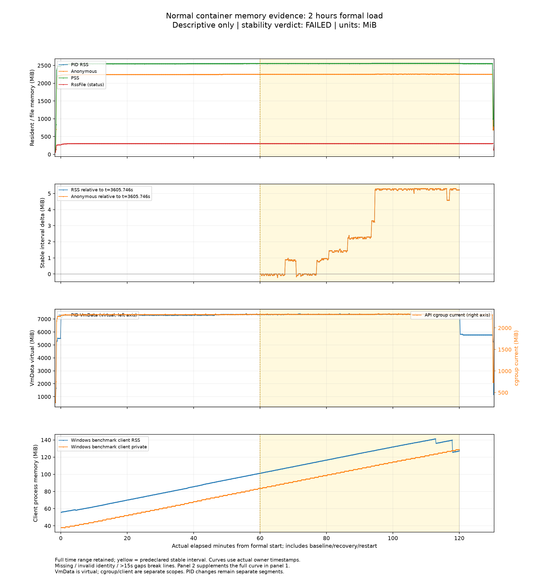

# 剩余内存增长定位与两小时稳定性验证

> **历史诊断与失败证据报告。** 更新：2026-10-27。原arena2两小时基线稳定性失败；arena2→1匹配诊断仅通过候选筛选，后续arena1两小时缺少完整收尾。新的[三小时正常入口验证](container-memory-three-hour-2026-10-27.md)已完整结束，正式144053/144053成功，但第二、第三小时RSS/Anonymous各增长5.8125 MiB，联合稳定性失败。拒绝推广arena1，生产默认保持arena2。下文的原两小时计划和历史失败保留，不混作新实验通过。

## 当前状态

| 阶段 | 状态 | 已知结果 |
|---|---|---|
| A：expanded1300、c32、20,800 请求 | COMPLETED | 20,800/20,800 成功，含 idle/GC/trim |
| B：original100、c32、20,800 请求 | FAILED | 20,799 成功、1 timeout；缺少 idle/GC/trim |
| A/B 失败证据审计 | FAILED_WORKLOAD_RECONCILED | 账本已对账；不等于实验通过 |
| encoder32 同包装器控制 | COMPLETED | 20,800/20,800 成功，完整采集 |
| encoder2 干预 | FAILED | 20,797 成功、3 timeout；候选拒绝，缺 idle/GC/trim |
| OMP unset 控制 | COMPLETED | 20,800/20,800 成功，完整采集 |
| OMP=1 干预 | COMPLETED；候选拒绝 | 20,800/20,800 成功，但275组完整结果指纹不同 |
| 正常入口 7200 秒持续验证 | FAILED_STABILITY_RECONCILED | 97868/97868搜索成功；内存联合门槛及一次 live 探测失败 |
| arena2→1 匹配对照 | PASSED；仅筛选资格 | 两组20800/20800成功，全部门槛通过、5200组完整指纹一致 |
| arena1正常入口 7200 秒验证 | INCOMPLETE | 101547次搜索结果已落盘，但缺少恢复、汇总及完整收尾，不验收 |
| 发布源码的arena1正常入口10800秒验证 | FAILED_STABILITY | 请求/业务通过，完整稳定窗口失败；拒绝推广arena1 |

基线证据目录为 `artifacts/extended-memory-2026-10-26/`，新增对照目录为 `artifacts/arena-count-2026-10-26/`。以下数字来自已落盘证据；未完成项不填入推算值。采集完成、失败对账或 HTTP 成功不等于候选通过。归档及发布校验仍在进行。

## 现象与待解释问题

[上一轮扩大负载验证](container-expanded-soak-2026-10-25.md)的 c32 小时末二十分钟门槛通过，但严格全小时 RSS 增加 55.984375 MiB，其中 Anonymous 增加 19.921875 MiB，非匿名 resident 增加 36.062500 MiB。首轮查询覆盖后仍出现匿名增长，不能因此宣称无泄漏或长时平台。

历史 THP 和 glibc arena 对照见[分配器报告](container-memory-arena-2026-10-25.md)。本轮继续沿用 THP-off、`MALLOC_ARENA_MAX=2`，进一步区分文件触页、glibc used/free、pymalloc 和匿名映射。不同统计口径可能重叠，不能相加解释 RSS。

## 冻结输入与诊断协议

接手基线为 `fae045d3539d40e702724949d47e44e551843e77`。A/B 使用同一冻结镜像 `searchpilot-validation:2026-10-25-expanded`，image ID 为 `sha256:e858d8af87d05a191aae11682d8098f3285eed0b487985d2fb3edf06492a36f1`；29 项保护输入及业务源码身份单独核验。模型、原 labels、依赖及私有 `.env` 不作为本轮改动。

expanded fixture 为 1300 条：原 100 条加 1200 条确定性合成查询，7 个 family、18 个 category、8–256 字符；SHA-256 为 `7356dc96df3a6d0d8bfc5c00d74ec284d7df22efec5bddba127b462e75be3ef6`。original100 SHA-256 为 `d5663200e2c7e98fbf283ef6333f53081725b44b947d70a3b2a8d94e6e65df69`。查询文件按实际使用字节冻结，不能以最终源文件代替运行快照。

顺序固定 A→B，每组使用同一全新诊断 PG 项目，API 强制重建；各 20,800 请求、HTTP c32、四模式轮转、limit10、总 timeout10 秒、16 次预热、无重试。两组改变查询集，也同时改变唯一性、长度、字符及检索工作量，不能分离这些因素的独立贡献。

五个检查点为完成 400/5200/10400/15600/20800 请求；中途不排空。native、完整 smaps、task IDs 顺序采集，记录触发及实际完成计数，因此不是同一时刻的原子观测。最终自然排空后计划 idle120 秒、显式 GC、显式 trim 各一次；不将这些干预加入服务。

诊断入口包含 allocator wrapper，不能替代正常入口验收。健康/PID/Docker stats 每十秒采样；只记录 native 环境白名单。Docker stats 与 Linux loadavg 不是完整 Windows 宿主 CPU 监测，也不能排除其他资源争用。

A 起始阶段曾并行进行本地回归与脚本镜像层构建，其他项目也有独立活动；这些运行不是独占宿主的吞吐对照。最终正常入口计划另记 Windows 全局 CPU 与可用内存，同时仍保留共享环境这一限制。

## 六组请求结果与失败保留

| case | 正式成功/发出 | 失败 | 实际分母秒 | 成功 req/s | 成功 p95 ms | 成功 p99 ms |
|---|---|---|---|---|---|---|
| expanded1300 | 20800/20800 | 0 | 2379.755795 | 8.740393 | 7099.741 | 8103.445 |
| original100 | 20799/20800 | 1 timeout | 1900.736678 | 10.942599 | 5385.145 | 7573.438 |
| encoder32 | 20800/20800 | 0 | 1923.839843 | 10.811711 | 4850.460 | 5760.729 |
| encoder2 | 20797/20800 | 3 timeout | 2059.601566 | 10.097584 | 5450.479 | 6184.073 |
| OMP unset | 20800/20800 | 0 | 1677.713991 | 12.397822 | 4601.174 | 5667.887 |
| OMP=1 | 20800/20800 | 0 | 1019.165185 | 20.408860 | 2306.394 | 2475.014 |

吞吐分母为完整负载测量时长，包含排空；成功延迟分位数不包含失败，但失败始终保留在正式请求分母。六组均保留 16/16 次成功预热、唯一 pending/result 配对和实际 HTTP 在途峰值 32；这不是服务端同时执行并发的证明。

A 的 5200 个 query×mode 组各成功 4 次。B 的 400 组各尝试 52 次，其中一次超时不计成功；共同 400 组已有成功结果的指纹一致。`comparison-failed.json` 明确区分 `workload_status=FAILED` 与 `evidence_status=RECONCILED`，不能将对账结果改称原 A/B 通过。

B 的 index13731 出现一次 10 秒超时；所有 20,800 请求结束后，原驱动成功断言失败，未进入 idle/GC/trim。缺失阶段必须保持“未执行”，不得补零、复制 A 或重新运行后覆盖。客户端超时也不证明服务端同步工作已经取消。

超时附近存在整体延迟抬升及其他项目容器活动，但关联不证明外部争用是唯一原因。原失败账本、日志、快照、失败后续计划和独立审计均保留；不提高 timeout、不降低并发、不用重试抹去失败。

## 定位一：文件 resident 有具体映射来源

A 的 ready→5200 完整 smaps RSS 增加 77.367188 MiB，其中匿名增加 37.554688 MiB，非匿名增加 39.812500 MiB。

其中 39.554688 MiB 来自同一文件映射：`/home/searchpilot/.cache/huggingface/hub/blobs/f3/f34dad568ecbc8f2452ae7ea84e72884e1bab4f299cec39fd8f978b5fba8d3c9`。该 VMA resident 从 82.636719 增至 122.191406 MiB，Anonymous 为零，增长为 clean 文件页；VMA 虚拟大小为 127.285156 MiB。

后续 `model-file-mapping.json` 通过同 inode/symlink 元数据，将其对应到 `BAAI/bge-small-en-v1.5` revision `5c38ec7c405ec4b44b94cc5a9bb96e735b38267a` 的 `model.safetensors`；只读取元数据，没有读取权重内容或重新加载模型。这支持模型文件驻留页增长的定位，不等于证明某条查询触及了哪些页。

其余 ready→5200 文件增长主要为 OpenBLAS 0.125000 MiB、NumPy 0.062500 MiB、tokenizers 0.062500 MiB。文件映射可以包含匿名 COW 页；本项已单独核验 Anonymous，不能普遍将所有带路径 RSS 都视为非匿名。

## 定位二：匿名增长与分配器保留

以下统一使用各检查点的**完整 smaps**，MiB 为 2²⁰ 字节；与稍早采集的 native rollup 数值可能略有不同。

| A 阶段 | RSS MiB | Anonymous MiB | glibc used MiB | glibc free MiB |
|---|---|---|---|---|
| warmup | 2480.820312 | 2212.437500 | 225.293472 | 33.577621 |
| after400 | 2528.085938 | 2238.207031 | 244.211731 | 33.065613 |
| after5200 | 2556.222656 | 2249.464844 | 244.048553 | 43.732697 |
| after10400 | 2556.316406 | 2249.558594 | 244.517868 | 43.263382 |
| after15600 | 2561.207031 | 2254.449219 | 242.872269 | 49.893356 |
| after20800 | 2561.207031 | 2254.449219 | 240.729813 | 52.035812 |
| idle120 | 2555.222656 | 2248.464844 | 226.087448 | 66.678177 |
| GC | 2555.222656 | 2248.464844 | 226.096146 | 66.669479 |
| trim | 2509.144531 | 2202.386719 | 226.101791 | 52.843521 |

400→5200 匿名增加 11.257812 MiB，glibc system 增加 10.503906 MiB，used 下降 0.163177 MiB、free 增加 10.667084 MiB。一个同基址匿名区间扩展的虚拟大小和 resident 净增也为 10.503906 MiB，但大小、对齐或地址本身不能确证分配器所有权。

10400→15600 RSS/Anonymous 增加 4.890625 MiB，同时 glibc arena 增加约 4.984375 MiB、used 下降、free 增加。A 的 pymalloc current arenas 保持 641；allocated blocks 有活动变化，不是完整活对象清单，也不排除 C 扩展的原生保留。

后续 `late-anonymous-step-audit.json` 对 37 份原始输入逐项绑定 SHA，进一步定位该台阶：同一无路径 `rw-p` VMA 的 Size/RSS/Anonymous 增加 5104 KiB，其 31040→36144 KiB 容量与 `malloc_info heap 1` 的 system current 精确对应，`mallinfo2 arena` 也增加 5,226,496 字节；其他映射匿名净减 96 KiB。同时 glibc used 减少约 1.646 MiB、free 增加约 6.630 MiB。该 VMA 在 idle/GC 后仍驻留 36144 KiB，trim 后降至 18240 KiB，支持分配器保留空闲驻留页的解释。

同一阶段线程总数仍为269，但有96个 task ID 加入、96个离开；8 MiB 加 guard 的几何映射类别驻留净减96 KiB，无法解释主要增长。encoder32 与 defaultOMP 的10400→15600匿名增量分别为0.273438与0.816406 MiB，也出现较小的分配区扩展及trim响应，未重现固定幅度或固定时点。heap编号与VMA没有直接API关联；数值对应与可回收性不能确定分配调用栈、库所有者或具体新增页面的生命周期。

A 最终 idle 后 GC 未减少此处 RSS，trim 后 RSS/Anonymous 降低 46.078125 MiB，支持存在可回收的分配器保留。总 trim 回收量不等于增量负载内存，不能据此给全部匿名增长指定来源。malloc_info 与 mallinfo2 是负载继续期间的非原子观测，其 free 增量不要求数值相同。

400 与 5200 两端 Linux 线程数均为 269，但只有 185 个 task ID 共有，84 个加入、84 个离开。线程总数稳定不能排除线程更替；十秒采样也可能漏掉短命线程，尚不能把匿名块归给线程栈或缓存。

## 启动基线差异不能当成查询效果

`startup-baseline-comparison.json` 显示 ready 的 A−B Anonymous 净差为 102.324219 MiB，恰落在每进程三个无路径、rw-p、各 1 GiB 虚拟大小的 VMA 组中；其余匿名映射净差为零。该组 A/B resident 合计分别为 1209.417969/1107.093750 MiB。

两组各自 ready→warmup 时，这三块映射 resident 均不变；glibc used 仅差 −11,968 字节、pymalloc allocated blocks 仅差 +480 字节。跨进程 ASLR 和布局不同，按映射形状分组不是分配对象身份匹配，所有者仍未知。不能将约 102 MiB 的启动差异归因于 expanded 查询处理。

该历史分析明确 B 当时仍 RUNNING，并嵌入当时 summary 的精确原文和哈希；`diagnostic-expanded-5200-preliminary.json` 也是局部观察，配套保存其当时 summary。历史 PARTIAL 不因后来完成而自动升级为最终结论。

## 候选一：编码并发限制未通过

limit32→limit2 对照均用 expanded1300、HTTP c32 和相同请求协议；同一个只读补丁包装编码器类 `__call__`，只改变信号量额度。实际派生 driver、base/patch/override 哈希、command/mount 与计数独立记录，不能冒充未打补丁的原版执行。

| case | 正式成功/发出 | 编码实际峰值 | 编码 started/completed 正式增量 | 最大编码等待秒 | idle/GC/trim |
|---|---|---|---|---|---|
| encoder32 | 20800/20800 | 32 | 15600/15600 | 0.047002 | 完整 |
| encoder2 | 20797/20800 | 2 | 15600/15600 | 10.946327 | 未执行 |

两组5200个成功结果组的完整结果、排名及模型指纹一致，但 encoder2 三次超时使其不满足零失败要求。`encoder-comparison-failed.json` 为 `FAILED_WORKLOAD_RECONCILED`，候选状态 `REJECTED_TIMEOUT_OR_FAILURE`。全部四次诊断超时如下；其余四组零超时：

| case | 正式 index | mode | query | 客户端 elapsed ms |
|---|---|---|---|---|
| original100 | 13731 | ltr | Garden State localities outlaw disposable toting sacks | 10023.582 |
| encoder2 | 1755 | ltr | Nimari Burnett | 10011.574 |
| encoder2 | 18818 | hybrid | nancy drew not | 10002.193 |
| encoder2 | 19381 | vector | Margaret Atwood Bears Witness | 10014.024 |

等待计数没有 request-ID 联接，不能断言最大等待就是某个超时请求。原局部 `encoder2-timeout-analysis.json` 的10.583秒是中途观察，最终最大值为10.946327秒。encoder2 在最终检查点计数已归零，但旧驱动随后因请求失败停止，恢复阶段及 final_container 缺失，不得事后补造。

按完整 smaps，encoder32/encoder2 的 warmup→after20800 Anonymous 分别增加35.058594/19.488281 MiB；5200→20800 分别增加0.753906/1.457031 MiB。较低的全段增量没有抵消超时，且后段增长并未优于控制。两组基线不同，不直接用绝对 RSS 比较效果；encoder32 的 GC→trim RSS/Anonymous 下降47.066406 MiB，encoder2 无恢复数据。

同步信号量等待继续占用 AnyIO 工作线程，客户端超时不终止同步计算；更少编码并发也未让整个进程只剩两个线程。该候选不推广，不调整生产默认值或超时预算。

## 候选二：OMP=1 生效，但结果一致性失败

按 `native-thread-control-plan.md`，两组保持HTTP c32、encoder32和相同新包装器，仅改变启动环境 OMP unset→1。其他线程控制变量按白名单一致；Compose子进程先移除宿主线程变量，容器Config/PID1环境及实际工作线程观测均核验。父级补丁只作未执行的来源参考，新补丁和执行副本单独标识。

| case | 正式调用前 getter | 正式调用后 getter | intra-op | inter-op | 编码峰值 | load Linux线程范围 |
|---|---|---|---|---|---|---|
| OMP unset | 15600/15600 可用 | 15600/15600 可用 | 始终6 | 始终6 | 32 | 197–275 |
| OMP=1 | 15600/15600 可用 | 15600/15600 可用 | 始终1 | 始终6 | 32 | 59–62 |

正式观测没有 unavailable/error/直方图溢出；两组启动首个编码前 torch 尚未导入的各一次 unavailable 单列，不混入正式分母。getter 是调用线程看到的配置，不代表忙碌线程数量，也不涵盖所有原生库。两组全部请求成功、5200组各4次、轮内指纹稳定，编码异常为零。

跨组却有 **275/5200 组 `result_sha256` 不同**：vector 137组、ltr 138组，其余4925组完整指纹相同。全部5200组的 `ranking_sha256`、model_version、result_count 一致。只保存了哈希，未保存原始分数；差异幅度及质量影响未知，不能擅称只是可忽略的数值误差。

严格 `semantic_equality` 已用完整组映射实际调用并拒绝，原因 `Cross-case semantic fingerprints differ`；没有额外重跑严格比较器CLI。`native-thread-comparison-rejected.json` 明确为 `REJECTED_RESULT_DIFFERENCE`、`evidence_status=RECONCILED`、`candidate_protocol_eligible=false`、`REJECTED_NO_PRODUCTION_PROMOTION`。HTTP成功和排名一致不覆盖精确结果门槛。

两组新驱动均在客户端排空后检查编码器 started/entered/completed 正式增量各15600且active/waiting为零，再采 after20800→idle120→GC→trim。编码器排空各耗时0.446572/0.442730秒；这不能单独证明超时业务的后续检索/序列化结束。客户端吞吐分母与该追加观测时间分开。

以下恢复数字使用完整 smaps；不同进程的绝对值只作描述，效果比较以各自 warmup 为基线。

| case/阶段 | RSS MiB | Anonymous MiB | glibc used MiB | glibc free MiB |
|---|---|---|---|---|
| OMP unset/after_20800 | 2570.507812 | 2264.742188 | 240.613251 | 48.394562 |
| OMP unset/idle | 2564.523438 | 2258.757812 | 226.158646 | 62.849167 |
| OMP unset/gc | 2564.523438 | 2258.757812 | 226.163483 | 62.844330 |
| OMP unset/trim | 2519.585938 | 2213.820312 | 226.126205 | 50.096451 |
| OMP=1/after_20800 | 2685.023438 | 2378.593750 | 829.336304 | 94.062134 |
| OMP=1/idle | 2600.015625 | 2293.585938 | 225.653992 | 200.013977 |
| OMP=1/gc | 2600.015625 | 2293.585938 | 225.661148 | 200.006821 |
| OMP=1/trim | 2514.707031 | 2208.277344 | 225.668900 | 199.874069 |

OMP unset/1 的 warmup→after20800 Anonymous 增量分别为36.332031/144.234375 MiB，5200→20800 为2.363281/36.429688 MiB；线程数下降没有改善本轮匿名增长。OMP=1 的 used 在排空快照约829.336304 MiB，idle后降至225.653992 MiB，不能把前者直接归为永久活对象。

两组 GC 均未降低这里的 RSS；GC→trim RSS/Anonymous 分别下降44.937500/85.308594 MiB。OMP=1 trim 后 glibc free 仍约199.874069 MiB，而 RSS明显下降，再次说明 free字节、驻留页和pymalloc不能相加或互换。OMP unset 的 pymalloc arenas从warmup642变为643，OMP=1维持635；这些数字不确证匿名映射所有者。

顺序与背景仍混杂：覆盖整个负载/恢复采样，OMP unset 181次中19次有其他容器、累计4个ID、最多同时2个；OMP=1 的115次未采到其他容器，但不证明宿主无争用。load live/ready分别168/168及102/102成功；实际时间覆盖保留在原始审计中。较快吞吐不能据此宣称因果加速，两个候选均不推广，生产配置保持原样。

## 候选三：减少arena数量，通过匹配筛选

新增匹配对照仅将 `MALLOC_ARENA_MAX` 从2改为1，同一冻结镜像、THP-off、c32、1300查询、四模式、20,800请求、16预热及10秒超时均不变；每组全新API进程，使用同一独立PG。先跑arena2，再跑arena1；不增加编码信号量、不设置OMP、trim或mmap阈值。全部10个快照必须实际观察到预期heap数，完整结果/排名/模型/数量指纹跨5200组一致，搜索和负载健康零失败。

运行前固定的筛选门槛：以每组自己的warmup为基线，after20800和idle的Anonymous增量均须减少至少2 MiB且至少20%；5200→20800后段增长不得比控制多1 MiB。控制增量非正时标记证据不足；吞吐不得低于控制80%，p95不得超过控制125%。统一使用native进程smaps_rollup的Anonymous字节，完整smaps单列，不择低；吞吐包含客户端排空。共享宿主顺序对照不构成因果吞吐声明。

| 指标 | arena2控制 | arena1处理 |
|---|---|---|
| 正式/预热成功 | 20800/20800；16/16 | 20800/20800；16/16 |
| 实际正式分母秒 | 1442.106695 | 1477.980231 |
| 成功请求/秒 | 14.423343 | 14.073260 |
| 成功p95 / p99毫秒 | 3257.224 / 3484.516 | 3342.568 / 3617.016 |
| warmup→20800 Anonymous增量MiB | 38.304688 | 27.734375 |
| warmup→idle Anonymous增量MiB | 32.585938 | 21.750000 |
| 5200→20800 Anonymous增量MiB | 2.046875 | 2.726563 |

负载终点/空闲终点分别少10.570313/10.835938 MiB（27.60%/33.25%）；处理组后段额外增长0.679688 MiB，低于1 MiB上限，但后段仍有增长，不能写成完全不增长。吞吐比0.975728、p95比1.026201，均通过预声明限制。

每组5200组各成功4次，组内及跨组result/ranking/model/count指纹全相等，客户端峰值32；十个malloc_info快照分别始终为2/1个heap。负载live/ready分别145/145和148/148成功，七组件为真；最大采样间隔10.026418/10.026761秒，首末覆盖合格。完整原始账本重算和独立数值复核均支持 `candidate_eligible=true`，只授予进入正常入口复验的资格。

两组证据单独封存为[arena数量对照原始ZIP](container-memory-arena-count-2026-10-26-raw.zip)：12,616,927字节、279成员，SHA-256 `c3c2b3b54bccd9fbf2dbf482f4edc56f9ac0e74d21637db6cdf572a30ec1f89b`。CRC、逐成员SHA回读及本地私有凭据扫描通过；`production_acceptance=false`。旧解析器的background分类包含本次项目本身，报告已标注，不能把其中other容器计数直接当作外部负载数量。

## 正常入口基线与固定接受标准

最终计划：7200 秒、c32、同一 1300 fixture、四模式、limit10、timeout10、16 预热、基线60秒和恢复600秒；独立项目/新卷，正常 docker_entrypoint，无诊断补丁、tracing、主动 GC/trim。最终镜像和源码在启动前冻结。

严格账本须零失败/未知/遗留/空成功；5200 组各至少成功12次、指纹稳定、客户端峰值32。所有 load live/ready 成功、7组件为真；全11来源可用、PID1一致、THP/swap/OOM为零、无意外重启，17项业务/计划重启和反馈持久性通过。

每十秒采样，窗口边界误差≤10秒、最大gap≤15秒、每窗至少 floor(window/10)−2 点。严格使用 phase=load 且 `[0,7200)`；前3600秒仍完整报告，不能事后挑选稳定起点。RSS 和 Anonymous 各自必须同时满足：

1. `[3600,7200)` 端点增长≤2 MiB，按实际时间 OLS≤0.03 MiB/分钟。
2. `[3600,4200)` 与 `[6600,7200)` 中位数差≤2 MiB。
3. 稳定期12个固定五分钟窗的中位数最大−最小≤2 MiB。
4. 起点3600、3900、…、6000的全部滑动20分钟窗，端点增长≤2 MiB、OLS≤0.1 MiB/分钟且覆盖完整。

| 原正常入口基线 | 全7200秒 | 各5/20分钟及两小时 | 稳定期联合门槛 | 末10/20分钟 | 恢复600秒/业务 |
|---|---|---|---|---|---|
| 完整结果 | 97868/97868搜索成功 | 全部固定窗口采样覆盖通过 | RSS / Anonymous各5项全部失败 | RSS各−0.015625 / +0.011719 MiB | 完整恢复、17项业务和计划重启通过 |

正式负载窗口零点为09:01:43.901351 UTC，首条请求事件为09:01:43.901881 UTC，最后搜索结果在11:01:45.913203 UTC完成；包含排空的实际分母为7202.012045秒。5200组各成功18或19次、组内指纹无变化、16/16预热成功、实际客户端峰值32，未知/遗留/空成功为零。负载720个样本、全11来源可用、PID身份一致，最大采样间隔10.027723秒；THP、swap、OOM均为零。

| 口径 | RSS MiB | Anonymous MiB |
|---|---|---|
| 全两小时端点增长 | 58.746094 | 25.867188 |
| 第二小时端点增长（上限2） | 5.222656 | 5.222656 |
| 第二小时 OLS MiB/分钟（上限0.03） | 0.120903 | 0.120903 |
| 稳定期首末十分钟中位数差（上限2） | 5.292969 | 5.292969 |
| 十二个固定五分钟中位数范围（上限2） | 5.308594 | 5.308594 |
| 恢复期首末下降量 | 5.898438 | 5.898438 |

要求每个滑动二十分钟窗均通过的联合门槛也失败。最后二十分钟接近平稳不能抵消第二小时的阶梯增长，也不能事后将稳定期移到最后二十分钟。没有缺失采样或资源审计错误来解释上述失败。

live为719/720成功、ready为720/720成功。10:48:01.653311 UTC的live探测出现TimeoutError，实际耗时4.438259秒，仍按原3秒预算记录为失败；不能用所有搜索成功覆盖它。该时段独立搜索账本也有约5.05秒事件空档，Docker资源观测同时变慢；这些是共同停顿的线索，准确根因仍未知。`FAILED_STABILITY_RECONCILED`表示完整原始证据重放与失败结论一致，不表示验收通过。

图保留基线、全负载、恢复及计划重启，第二面板只放大预先声明的第二小时。Windows压测客户端单列；它保留请求结果列表用于最终汇总报告，账本则逐条写盘，其增长不能归到服务进程RSS。

RSS/Anonymous/PSS/VmData/cgroup/客户端资源分别报告，缺失不填零。PSS受共享映射者影响，VmData/cgroup不直接套用RSS门槛。失败不改阈值；若实施服务修复，重新冻结并完整复跑受影响对照及7200秒验证。

## 证据与交付边界

本地已完成诊断补丁的无模型并发/异常释放、线程观测和环境隔离检查及静态检查。六组诊断的编码并发/OMP候选均未通过；arena1候选只通过匹配筛选，后续三小时正常入口稳定性仍失败。完整结果及交付清单见三小时报告，CI不替代资源验收。

原失败基线及六组诊断已独立封存为[完整原始证据 ZIP](container-memory-stability-2026-10-26-baseline-raw.zip)：74,937,021字节，499成员（497原证据及2生成清单），SHA-256 `92c29a54ff633797f29d60bf948645a950ee785f209c86318ef3936a1523a5b2`。CRC、每成员SHA回读、当前源一致性及本地私有凭据值扫描均通过。包含运行前计划、所有成功与失败账本、smaps/native、环境白名单、来源哈希、派生执行manifest、背景记录、健康失败审查和独立重放；`EVIDENCE-SCOPE.json`明确 `production_acceptance=false`。该包不包含后续arena数量对照或候选正常验收。

本内存实验外部 LLM 调用为0，不覆盖或改写其他Agent验证证据。查询合成不是人工标签或真实流量；本文不证明无限运行稳定、零泄漏、检索相关性或容量SLA。原项目卷、其他项目资源与私有 `.env` 保留。
