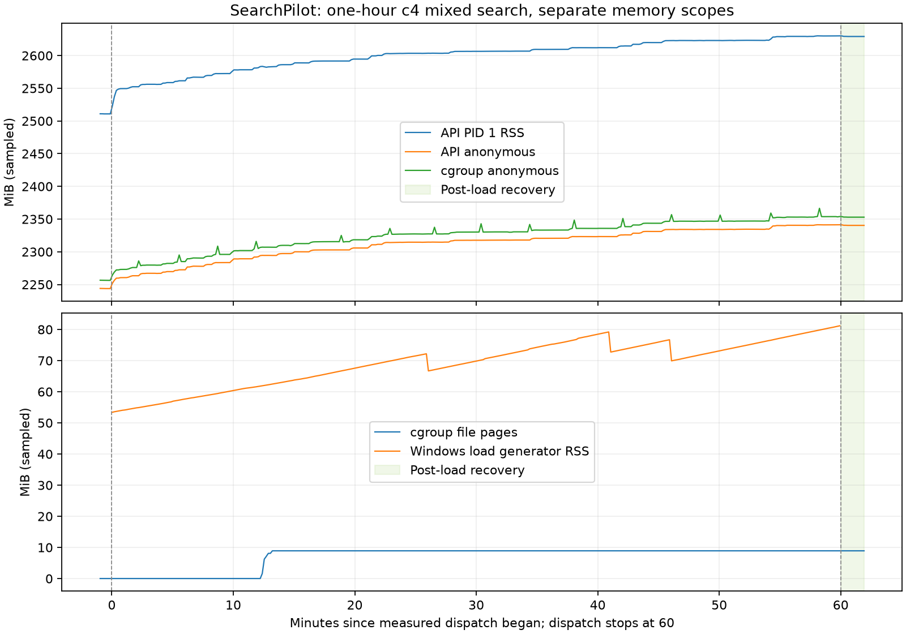

# 容器内存：THP 对照与一小时复验

实验执行于 2026-10-23，结果及清理记录于 2026-10-25 整理。**进程级禁用 THP
消除了短对照中的空闲期增长，但一小时复验仍存在匿名内存增长，尚未平台化。**
本报告记录已完成的 THP 实验，不包含后续 arena 对照的结果。

## 对照确认了什么

在同一完整 API 镜像、冻结模型、100 条查询、4 种模式、并发 4 下，按 A/B/A
顺序执行系统默认、进程禁用 THP、恢复默认。每轮正式 4,000/4,000 成功，另有
16/16 预热；400 个组合各重复 10 次，结果指纹稳定、账本完整。

| 轮次 | 预热后至 4,000 次 RSS 增量 | 随后约 120 秒空闲增量 | 合计 RSS 增量 | 同区间 AnonHugePages 增量 |
|---|---:|---:|---:|---:|
| `diag-default-02` | +62.24219 MiB | +13.95703 MiB | +76.19922 MiB | +128 MiB |
| `diag-no-thp-01` | +37.49219 MiB | −0.61328 MiB | +36.87891 MiB | 0 MiB |
| `diag-default-03` | +72.37891 MiB | +15.14453 MiB | +87.52344 MiB | +126 MiB |

MiB = 1,048,576 字节。B 的所有诊断快照 `THP_enabled=0`、`AnonHugePages=0`。
无诊断控制线程的 `plain-default-01` 也复现了空闲期 +17.06250 MiB，支持现象
并非只由诊断控制线程引起。A/B/A 支持 **THP 是该环境下空闲增长的可干预原因之一**；
只有一次 B、非随机顺序且共用主机，不能量化一般性收益或宣称吞吐非劣。

一份默认策略 smaps 差分把整个进程 +17.37891 MiB 中的 +16.91406 MiB 定位到
同一大小为 1 GiB 的匿名映射；该映射 THP 增加 68 MiB，创建者仍未知。
RSS 与 AnonHugePages、glibc、pymalloc 统计范围重叠，不能相加或据地址猜测所属库。
默认轮第 400/4,000 次及空闲检查点的 pymalloc arena 恒为 642，活跃块近似稳定，
glibc 活跃分配未随 RSS 同量增加；这些有限观察不能证明所有分配域均无泄漏。
诊断结束后 trim 可回收约 32–34 MiB，也不能把全部增长归因于 glibc。
稀疏访问的 THP 驻留放大与进程级控制机制见 [Linux 内核文档](https://docs.kernel.org/admin-guide/mm/transhuge.html)。

## 一小时复验：业务通过，内存仍增长

正式窗口为 2026-10-23 **10:12:06.514217–11:12:06.810318 UTC**：
调度 3600 秒，随后排空约 0.296 秒；此前有 60 秒基线，之后有 120 秒恢复。
使用正常容器入口，无诊断控制服务、tracemalloc、主动 GC 或 trim。

| 项目 | 实际结果 |
|---|---|
| 正式 / 预热请求 | 49,692/49,692 / 16/16 成功；无失败、未知或遗留 pending |
| 并发与账本 | 峰值在途 4；99,416 条事件完整配对为 49,708 个请求 |
| 模式与指纹 | 各模式 12,423 次；400 组指纹稳定，92 组重复 125 次、308 组重复 124 次 |
| 吞吐 / 延迟 | 13.8022 请求/秒；成功请求 p95 498.115 ms、p99 579.565 ms |
| 健康探针 | 负载期 live / ready 各 360/360 HTTP 200；ready 各项检查为真 |
| 业务与重启 | 17/17 检查通过，含预期 409/404 拒绝；重启后同一反馈 event_id 幂等重放 |
| 进程与资源 | 负载 360 个样本的进程启动标识一致，FD 恒 20，所采 OOM 计数均 0 |
| THP | 负载 360/360 样本 `THP_enabled=0`、`AnonHugePages=0` |

吞吐分母包含末尾排空，延迟分母为全部 49,692 个成功请求。最终 Docker 快照的
健康状态仍为 `starting`，其历史包含启动期间连接拒绝；随后记录的 HTTP
`restart_ready` 全部为真且反馈重放成功。不能将快照写成最终 Docker `healthy`，
也不能仅凭启动窗口快照认定重启失败。

| RSS 观察区间 | 首末（MiB） | 增量（MiB） | OLS 斜率（MiB/分钟） |
|---|---:|---:|---:|
| 负载 360 点，59.8753 分钟 | 2522.69531 → 2630.14844 | +107.45313 | +1.25733 |
| 末 20 分钟，120 点、19.8491 分钟 | 2612.10156 → 2630.14844 | +18.04688 | +0.86409 |
| 末 10 分钟，60 点、9.8414 分钟 | 2623.02344 → 2630.14844 | +7.12500 | +0.97494 |
| 恢复期 12 点，约 110 秒 | 2630.06250 → 2629.19531 | −0.86719 | — |

OLS 使用真实采样时间拟合，仅作描述。末 20 分钟增长全部来自匿名页；全部
12 个五分钟窗口均净增长。末五分钟虽仅 +1.25391 MiB，不能据此宣称平台化。
短诊断在第 400 次及后续每 800 次排空后采样，正式负载持续闭环且每 10 秒
调用 live/ready；这一区别意味着短诊断的趋稳不能外推一小时。新的根因实验必须
复现持续负载协议。图中 PID1、cgroup 和压测客户端内存分别展示，不能混用范围。



## 修复、来源与复现

容器入口在迁移、seed 和模型导入前应用 `SEARCHPILOT_DISABLE_THP=true`：
设置进程 `PR_SET_THP_DISABLE=1` 并严格读取核验，跨 exec 保留；不改宿主 sysfs
或容器权限。配置 false 执行 SET0 恢复系统策略，不保证系统分配大页。非法配置、
Linux syscall 失败或 GET 不符阻止启动；非 Linux 明确记录不支持。本轮没有生产
定时 GC/trim、替换分配器或修改模型、查询及原始标注。

对照镜像为 `sha256:5dace93aa828fdece3cc5f689edf8c08db98f0d2a6900236cccbdafedbefed6d`；
正式镜像 `searchpilot-validation:2026-10-23-thp` 为
`sha256:d11f035548cfef1452d53c4f43d4e4e76c84d89026cc8dc4aad020579933568c`，
在原镜像上更新脚本与 THP 默认设置。Docker 分配 12 CPU、8,171,167,744 字节内存；
Linux 内核 `6.18.33.2-microsoft-standard-WSL2`。完整包版本、构建文件与命令见原始包。

正式开始前比对容器源文件 77 个、实际安装源文件 73 个；结束后确认生产与测量
源码未变，26 个冻结输入（迁移、queries、labels、模型产物）哈希一致。A/B/A
诊断 wrapper 执行哈希均为 `b064f68186ea0c4cdbda46105f108a8a8dc99056ad0b8dd9e48daa0b71d8ca3d`；
首轮驱动早于 THP 开关扩展，B 与末轮 A 的驱动相同。各轮执行快照原样保留。

在具有冻结输入和上述已构建镜像的环境中，以全新独立项目与输出目录执行：

```powershell
.venv/Scripts/python.exe -m scripts.validate_container_soak --out artifacts/allocator-2026-10-23/hour-001 --project sp-thp-hour-20261023 --image searchpilot-validation:2026-10-23-thp --duration-seconds 3600 --concurrency 4 --api-port 18084 --db-port 15435
```

该命令记录历史参数；复跑应换未使用的项目、端口及输出目录。原始包保留 setup、
对照 `experiment.executed.py`、覆盖配置、请求账本、完整 smaps、采样、分析脚本和
输入哈希。使用公开 `.env.example`；私有 `.env` 未归档、未提交，外部 LLM 调用为 0。

## 检查与证据

本地检查：621 单元通过、3 跳过、68 subtest 通过；独立测试数据库 14 项 PG
集成通过；Ruff、188 文件格式检查及 73 源文件 Mypy 通过。Linux 独立 smoke
验证 THP 开关跨 exec 的 GET1/GET0，以及 glibc/pymalloc 统计；不把 Windows
跳过项计为通过。前期 Windows HTTP 超时预算和拒绝请求测试失败及修复后日志
均保留：`unit-final.txt`、`unit-repaired.txt`、`targeted-tests-final.txt`、
`targeted-tests-repaired.txt`。本报告不代替最新提交的 CI 或合并记录。

诊断项目与小时项目的自有容器、卷已按项目标签核验后清理，原
`searchpilot_pgdata` 卷元数据前后不变。annotator 与原始实验来源保持原记录。

- [机器可读摘要](container-memory-thp-2026-10-23-summary.json)
- [原始证据 ZIP](container-memory-thp-2026-10-23-raw.zip)：170 个证据文件，
  23,652,344 字节，逐成员哈希回读校验通过，私有凭据匹配数 0。
  SHA-256：`7663226cd33c5ba1cdb352a5745e425070159c5e43079448b86588987047a5f4`。
- ZIP 中 `hour-independent-audit.md` 为独立原始账本及尾段斜率审计；
  `final-integrity.json`、`cleanup-hour.json` 分别记录最终完整性与清理证据。
