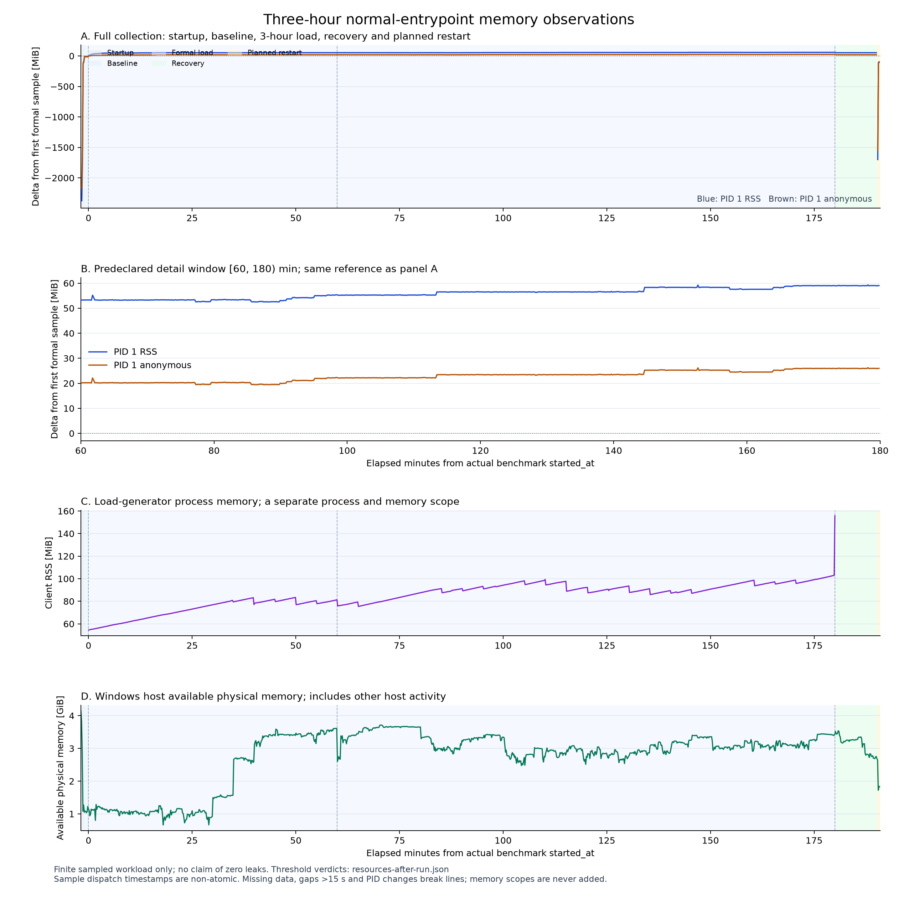

# 三小时持续验证：业务通过，arena1 稳定性未通过

本轮完成正常容器入口、并发32、1300查询、四模式的10800秒正式负载及600秒恢复，
采集器、压测器和外层监控均完整结束。正式请求 **144053/144053** 成功，业务与结果
一致性通过；但预先固定的第二、第三小时联合稳定性门槛失败。**拒绝将 arena1 候选
作为生产默认，继续保留 arena2；不宣称剩余内存增长已解决。**

## 协议与来源

运行前冻结119项Python源码、29项数据/模型输入与公共配置，启动前准备清单见原始包
`preparation-release.json`；其 `PREPARED_NOT_LAUNCHED` 是当时快照，不覆写成完成。
实际状态以 `launcher.json`、harness `summary.json` 和 `soak.json` 三层记录为准。
负载完成后另保存123项源码/公共配置的字节副本，再撤回未通过的生产配置候选。
拒绝的配置补丁保存在 `rejected-arena1-candidate.patch`，没有丢弃实验来源。

使用独立项目 `sp-agent-memory-20261027`、新PG16卷、正常 `docker_entrypoint`，
`MALLOC_ARENA_MAX=1`、THP关闭，不加入诊断包装器、tracing、定时GC或trim。
不可变镜像为 `sha256:b8c42b9b10d167dbd4fc9cd5fa4cbbfd6cae4e40102ee4343347978b27903b08`。
镜像在保留模型/依赖的基础上复制本轮源码、补齐已声明Agent依赖，不是生产Dockerfile
从零重建。它包含已合并Agent源码，不是与旧基线仅改变arena数量的纯因果对照。

查询字节SHA-256为 `7356dc96df3a6d0d8bfc5c00d74ec284d7df22efec5bddba127b462e75be3ef6`，
原100条加1200条确定性合成负载查询。并发32、limit10、请求总超时10秒、预热每模式4次，
不重试、不降低并发、不延长健康探测预算。本内存实验不读取私有 `.env`，外部LLM调用0；
同日另行发布的Agent模型验证不计入本实验。

## 业务、账本和采样完整性

| 项目 | 结果 |
|---|---|
| 正式请求/预热 | 144053/144053；16/16成功 |
| 失败、未知、遗留、空成功 | 均为0 |
| 实际分母（含排空） | 10802.056149秒 |
| 成功p50/p95/p99 | 2870.215/3832.061/4689.344毫秒 |
| 5,200个查询×模式组 | 3653组28次、1547组27次成功 |
| 结果/排名/模型/条数指纹 | 轮内一致，且逐组与arena1筛选组相同 |
| 客户端实际在途峰值 | 32，不等同于服务端同时执行32个任务 |
| 正式窗口健康与资源样本 | 1079点，live/ready全部成功，七组件和11来源可用 |
| 独立PID1观察 | 1079点，同一进程身份，实际环境一致 |
| 最大采样间隔 | 资源10.031607秒；独立观察10.037134秒 |
| 业务与计划重启 | 17项通过，反馈重启后持久 |
| THP、swap、OOM、意外重启 | 未发生 |

严格正式区间为 `[0,10800)`，不是把所有标记为load的点都计入分母。名义1080次与
实际1079点的差异完整保留；首末边界、最大间隔和每窗最低点数均满足预声明覆盖门槛。
固定稳定窗口 `[3600,10800)` 共719点，第一点3605.531秒、最后一点10790.737秒。

独立补充审计逐行检查客户端资源、Docker stats、宿主CPU/可用内存、Linux loadavg、
容器身份、cgroup events必需键和16次预热。后台允许其他项目容器，但必须包含本项目
两个容器且全部记录有效；正式样本只允许本项目两个。共享宿主活动有记录，不能声称
独占资源或把吞吐变化归因于本候选。

## 为什么不能称为稳定

| 预声明稳定窗口指标 | RSS | Anonymous | 门槛 |
|---|---:|---:|---:|
| 第二、第三小时端点增长 | 5.812500 MiB | 5.812500 MiB | ≤2 MiB |
| 全稳定窗口OLS | 0.057229 MiB/分钟 | 0.057229 MiB/分钟 | ≤0.03 |
| 首末十分钟中位数差 | 5.730469 MiB | 5.730469 MiB | ≤2 MiB |
| 24个五分钟中位数极差 | 6.433594 MiB | 6.433594 MiB | ≤2 MiB |
| 21个滑动二十分钟全部通过 | 否 | 否 | 全部满足增长≤2、OLS≤0.1 |

两项指标的五类门槛均失败。原联合审计与独立资源CLI结果主体完全相同；`errors=[]`
表示解析和证据完整性没有错误，**不表示资源门槛通过**。

全三小时RSS增长59.027344 MiB，Anonymous增长25.964844 MiB。按固定小时切分，
RSS分别增加53.285156、3.300781、2.511719 MiB；后两小时的增长均为匿名增长。
末二十分钟只增长1.464844 MiB、OLS为0.080718，虽满足旧末窗筛查限制，仍不能覆盖
完整稳定窗口的失败，更不能事后把稳定起点移至最后二十分钟。

恢复期有60个样本。末次负载→末次恢复，RSS/Anonymous均下降5.984375 MiB；
仅计算恢复期首末样本，下降4.460938 MiB。两者起点不同，不混用或相加。回落支持
存在可回收部分，但没有给全部晚期增长确定分配调用栈，也不能证明没有泄漏。

图保留启动、基线、全负载、恢复和计划重启，稳定窗口单独展开；缺失、长间隔和PID
变化断线，不插值。客户端保留请求结果用于汇总，其内存与服务端分开报告，不相加。

## 根因边界与交付

[前置诊断与匹配对照](container-memory-stability-2026-10-26.md)支持模型文件驻留页与
glibc空闲驻留页保留对增长有贡献。arena2→1匹配筛选确有内存收益，但筛选资格不能
替代本轮正常入口验收。此次拒绝候选，不修改既定阈值，也不加入定时GC/trim掩盖现象。

复查没有发现搜索Python热路径中明显的无界查询缓存。AnyIO闲置线程裁剪与原生线程
生命周期是待验证方向，但历史线程更替量与匿名增长并非一一对应，且本机与容器库版本
不同；不能直接宣称固定线程池会解决问题。归档保存了这个假设、反例及下一步单变量
对照方案，未执行的方案不写成实验结果。

交付新增固定窗口资源审计，并将压测/对账的显式时长上限扩展到14400秒；默认负载参数
不变。资源审计明确不替代请求或业务验收。生产Docker/Compose仍为arena2，原模型、
labels、其他项目资源与私有 `.env` 保留。完整验收失败如实发布，不把CI通过写成内存修复。

## 证据文件

- [机器汇总与全部资源窗口](container-memory-three-hour-2026-10-27-summary.json)。
- [本次三小时原始证据](container-memory-three-hour-2026-10-27-raw.zip)：包含运行前计划、
  三层收尾、逐请求账本、原始资源、独立复算、来源快照及候选拒绝记录。
- [此前未完整收尾的arena1两小时证据](container-memory-arena1-interrupted-2026-10-27-raw.zip)。
  原状态和缺失阶段保持原样，不回填成功，不用新运行覆盖旧运行。
- [前置诊断与原arena2失败基线](container-memory-stability-2026-10-26-baseline-raw.zip)，
  [arena数量匹配筛选](container-memory-arena-count-2026-10-26-raw.zip)。

最终归档SHA、完整性/私有值检查和自有资源清理记录见
[交付清单](container-memory-three-hour-2026-10-27-delivery.json)。
